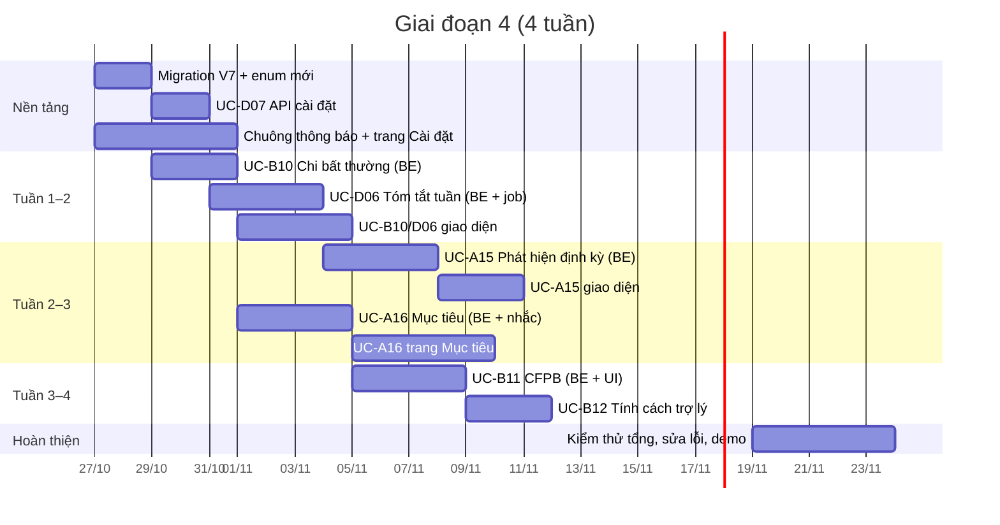
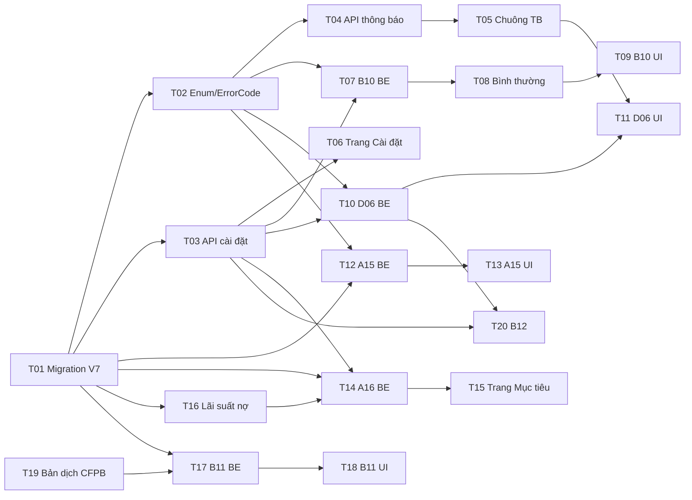

# Kế hoạch & Use Case — Giai đoạn 4

**Đề tài:** AI Chatbot RAG hỗ trợ quản lý và tư vấn tài chính
**Phạm vi giai đoạn 4:** 5 nhóm chức năng mới dựa trên nghiên cứu hành vi tài chính và các ứng dụng tương tự (Rolly, Cleo, Copilot Money, Rocket Money)
**Tài liệu gốc:** [`USE_CASES.md`](USE_CASES.md) (UC-A01 → UC-D05, BR-01 → BR-12, E-01 → E-18). Tài liệu này **bổ sung**, không thay thế.
**Ngày lập:** 26/10/2026 · **Phiên bản:** 1.0

> Cách đọc nhanh: thành viên mới đọc §1 → §3 (bối cảnh, cách chạy, quy ước), rồi nhảy tới use case mình được giao ở §7 và các mục kỹ thuật liên quan ở §8–§10. Trưởng nhóm đọc §4–§6 và §11–§13.

---

## Mục lục

1. [Giới thiệu](#muc-1)
   - 1.1 [Mục đích tài liệu](#muc-1-1)
   - 1.2 [Mục tiêu giai đoạn 4](#muc-1-2)
   - 1.3 [Ngoài phạm vi](#muc-1-3)
2. [Hiện trạng hệ thống](#muc-2)
   - 2.1 [Đã hoàn thành](#muc-2-1)
   - 2.2 [Công nghệ & cấu trúc mã nguồn](#muc-2-2)
   - 2.3 [Thành phần sẵn có mà giai đoạn 4 dùng lại](#muc-2-3)
3. [Hướng dẫn cho thành viên](#muc-3)
   - 3.1 [Chạy dự án trên máy](#muc-3-1)
   - 3.2 [Quy ước code bắt buộc](#muc-3-2)
   - 3.3 [Quy trình Git & Pull Request](#muc-3-3)
4. [Tổng quan chức năng mới & căn cứ](#muc-4)
5. [Kế hoạch thực hiện](#muc-5)
   - 5.1 [Vai trò & phân công](#muc-5-1)
   - 5.2 [Lộ trình 4 tuần](#muc-5-2)
   - 5.3 [Danh sách công việc chi tiết](#muc-5-3)
   - 5.4 [Phụ thuộc giữa các công việc](#muc-5-4)
   - 5.5 [Mốc kiểm tra & demo](#muc-5-5)
6. [Actor & Business Rule mới](#muc-6)
7. [Đặc tả Use Case](#muc-7)
   - 7.1 [UC-D07 — Cài đặt thông báo & tính cách trợ lý](#uc-d07)
   - 7.2 [UC-D06 — Tóm tắt chi tiêu hằng tuần](#uc-d06)
   - 7.3 [UC-B10 — Cảnh báo khoản chi bất thường](#uc-b10)
   - 7.4 [UC-A15 — Phát hiện khoản định kỳ](#uc-a15)
   - 7.5 [UC-A16 — Mục tiêu chính & nhắc theo mục tiêu](#uc-a16)
   - 7.6 [UC-B11 — Điểm sức khỏe tài chính (thang CFPB)](#uc-b11)
   - 7.7 [UC-B12 — Tính cách trợ lý](#uc-b12)
   - 7.8 [Ma trận Actor – Use Case & quan hệ](#muc-7-8)
8. [Thiết kế dữ liệu](#muc-8)
9. [Thiết kế API](#muc-9)
10. [Tác vụ nền & thuật toán](#muc-10)
11. [Giao diện](#muc-11)
12. [Kế hoạch kiểm thử](#muc-12)
13. [Rủi ro & cách giảm thiểu](#muc-13)
14. [Định nghĩa "Hoàn thành" & checklist PR](#muc-14)
15. [Phụ lục](#muc-15)
   - A. [Nguồn tham khảo](#phu-luc-a)
   - B. [Thuật ngữ](#phu-luc-b)
   - C. [Mẫu báo cáo tiến độ hằng tuần](#phu-luc-c)

---

<a id="muc-1"></a>
## 1. Giới thiệu

<a id="muc-1-1"></a>
### 1.1 Mục đích tài liệu

- Giao việc rõ ràng cho từng thành viên: **ai làm gì, làm theo thứ tự nào, xong khi nào thì gọi là xong**.
- Đặc tả đầy đủ 7 use case mới theo đúng khuôn mẫu của `USE_CASES.md` để mọi người code cùng một cách hiểu.
- Ghi lại **căn cứ** (nghiên cứu, ứng dụng thật) cho từng chức năng — dùng lại được khi viết báo cáo và trả lời hội đồng.

<a id="muc-1-2"></a>
### 1.2 Mục tiêu giai đoạn 4

| # | Mục tiêu | Đo bằng |
|---|---|---|
| G1 | Người dùng **nắm được tình hình chi tiêu mà không phải tự mở báo cáo** | Tóm tắt tuần + cảnh báo khoản chi bất thường hoạt động, có bật/tắt |
| G2 | Giảm công nhập liệu lặp lại | Phát hiện được khoản định kỳ từ dữ liệu tự ghi, tạo quy tắc bằng 1 lần bấm |
| G3 | Tăng khả năng đạt mục tiêu tiết kiệm | Có giao diện mục tiêu, mục tiêu chính, lời nhắc nêu đúng tên mục tiêu và số tiền cần để dành |
| G4 | Có thước đo sức khỏe tài chính chuẩn hóa để cá nhân hóa tư vấn | Bài đánh giá 10 câu (CFPB), lưu lịch sử, đưa vào tóm tắt cho UC-B02 |
| G5 | Tăng tính gắn kết | Trợ lý có 3 giọng văn, không làm sai lệch số liệu |
| G6 | Giữ chất lượng | Không phá BR-01 → BR-12; toàn bộ test cũ vẫn qua; mỗi UC mới có test |

<a id="muc-1-3"></a>
### 1.3 Ngoài phạm vi

| Không làm | Lý do |
|---|---|
| Liên kết tài khoản ngân hàng / đọc email ngân hàng | Đề tài chỉ dùng nguồn mở; không có API mở cho ứng dụng cá nhân |
| Tự động hủy dịch vụ thay người dùng (như Rocket Money Premium) | Cần quyền thao tác trên tài khoản bên thứ ba |
| Thử thách tiết kiệm với bạn bè, ví chung | Tính năng mạng xã hội, ngoài phạm vi; để Backlog |
| Dự báo chi tiêu bằng mô hình học máy | Đã đưa vào Backlog từ giai đoạn 1 (`USE_CASES.md` §11) |
| Gửi thông báo đẩy (push) / email / SMS | Giai đoạn này chỉ dùng thông báo trong ứng dụng (bảng `notifications`) |

---

<a id="muc-2"></a>
## 2. Hiện trạng hệ thống

<a id="muc-2-1"></a>
### 2.1 Đã hoàn thành (giai đoạn 1 → 3 và các bổ sung)

| Nhóm | Đã có | Ghi chú |
|---|---|---|
| Nền tảng | Spring Boot 3.5 + Hibernate DAO thủ công, Flyway V1–V6, JWT, phân quyền USER/ADMIN | 110 test tự động đang qua |
| Quản lý tài chính | A01 Ví, A02 Giao dịch, A03 Danh mục, A04 Ngân sách, A05 Mục tiêu, A06 Nợ, A07 Định kỳ, A08 Lọc, A09 Báo cáo, A10 Xuất file | **A05, A06, A07 mới có API, chưa có giao diện** |
| AI | Intent Router (có luật nhanh), A11 Chat, A12 Giọng nói, A13 Hỏi số liệu, **A14 Quét hóa đơn**, B01 RAG, B02 Tư vấn, B07 Tỷ giá, C01 Kho tri thức, C03 Đo chất lượng | Stream câu trả lời (SSE), yêu cầu dự phòng song song, embedding song song |
| Giao diện | Đăng nhập, Tổng quan, Giao dịch, Ví, Ngân sách, Trò chuyện, Admin: Tổng quan + Kho tri thức | Bố cục kiểu Rolly: thanh dưới (điện thoại), thanh dọc (máy tính) |
| Chưa có giao diện | Mục tiêu, Nợ, Định kỳ, Cài đặt / Hồ sơ, **chuông thông báo**, Admin C02/C04/C05/C06 | Giai đoạn 4 làm một phần (xem §5.3) |

<a id="muc-2-2"></a>
### 2.2 Công nghệ & cấu trúc mã nguồn

```
MidTerm/
├── USE_CASES.md                      ← đặc tả gốc
├── KE_HOACH_GIAI_DOAN_4.md           ← tài liệu này
└── fintech-chatbot/
    ├── pom.xml                        Java 21, Spring Boot 3.5.x, Hibernate 6.6
    ├── src/main/java/com/fintech/chatbot/
    │   ├── ai/                        IntentRouter, Prompts, client (OpenAI-compatible), handler, rag, market
    │   ├── calculator/                công cụ mô phỏng (B05)
    │   ├── common/                    ApiResponse, ErrorCode, BusinessException, MoneyParser, MoneyFormatter
    │   ├── config/, security/         SecurityConfig, JWT, properties
    │   ├── controller/ (+ admin/)     REST API
    │   ├── dao/                       GenericDao → AbstractHibernateDao, UserOwnedDao (lọc theo user_id)
    │   ├── dto/request|response, mapper/ (MapStruct)
    │   ├── entity/ (+ enums/)
    │   ├── scheduler/                 DailyReminderJob (07:00 hằng ngày)
    │   └── service/ (+ impl/, support/)
    ├── src/main/resources/
    │   ├── application.yml, application-dev.yml, application-h2.yml
    │   └── db/migration/V1..V6, db/vendor/{h2,postgresql}/V5
    ├── src/test/java/...              AiFlowTest, FinanceFlowTest, FakeAiConfig (AI giả lập), ...
    └── frontend/                      React 19 + Vite + TypeScript + Tailwind 4
        └── src/{api, auth, components, hooks, lib, pages}
```

<a id="muc-2-3"></a>
### 2.3 Thành phần sẵn có mà giai đoạn 4 dùng lại

| Thành phần | Vị trí | Dùng cho |
|---|---|---|
| `DailyReminderJob.runFor(LocalDate)` | `scheduler/` | Thêm bước nhắc mục tiêu (A16), phát hiện định kỳ (A15) |
| `BudgetAlertService.checkAfterExpense(...)` | `service/support/` | Điểm móc để gọi kiểm tra chi bất thường (B10) ngay sau khi lưu khoản chi |
| `NotificationDao.exists(userId, type, refId)` | `dao/` | Chống gửi trùng: tóm tắt tuần dùng `refId = yyyyww`, chi bất thường dùng `refId = transactionId` |
| `NotificationType` | `entity/enums/` | Thêm `WEEKLY_SUMMARY`, `UNUSUAL_SPENDING`, `RECURRING_DETECTED`, `PRICE_CHANGE`, `GOAL_REMINDER` |
| `RecurringRuleService` + `/api/recurring-rules` | `service/`, `controller/` | Chấp nhận gợi ý định kỳ → tạo quy tắc (A15) |
| `SavingGoalService` + `/api/saving-goals` (deposit/withdraw) | | Trang mục tiêu (A16) |
| `FinancialSummaryBuilder` | `ai/handler/` | Đưa điểm CFPB (B11) và trạng thái nợ (BR-14) vào tóm tắt cho UC-B02 |
| `AiDataPermission` (D05) | `entity/` | Mọi chức năng AI mới phải tôn trọng quyền dữ liệu |
| `LlmClient` (hedged request, stream) | `ai/client/` | Diễn đạt theo tính cách (B12), có thời hạn chờ ngắn và câu mẫu dự phòng |
| `FakeAiConfig` | `src/test/.../ai/` | Mọi test AI dùng bản giả lập, **không gọi API thật** |

---

<a id="muc-3"></a>
## 3. Hướng dẫn cho thành viên

<a id="muc-3-1"></a>
### 3.1 Chạy dự án trên máy

Yêu cầu: JDK 21, Node.js 20+, (tùy chọn) PostgreSQL 16 + pgvector. Mặc định chạy bằng H2 file, không cần cài DB.

```bash
# 1. Backend (profile dev + h2), cổng 8080
cd fintech-chatbot
./mvnw spring-boot:run -Dspring-boot.run.profiles=dev,h2
```

```bash
# 2. Frontend (hot reload), cổng 5173, tự proxy /api sang 8080
cd fintech-chatbot/frontend
npm install
npm run dev
```

```bash
# 3. Toàn bộ test (AI giả lập, không cần API key)
cd fintech-chatbot
./mvnw test
```

- **API key AI:** đặt biến môi trường `VILAO_API_KEY` trên máy mình. **Không** dán key vào code, file cấu hình, tin nhắn nhóm hay commit. Không có key thì app vẫn chạy, riêng chức năng AI báo `AI_NOT_CONFIGURED`.
- **Tài khoản admin chạy thử (chỉ profile h2):** cấu hình trong `application-h2.yml`; đổi bằng biến `ADMIN_PASSWORD` nếu cần.
- **Swagger:** `http://localhost:8080/swagger-ui.html` khi chạy profile dev.
- **Build bản gộp:** `npm run build` trong `frontend/` (xuất ra `src/main/resources/static`) rồi `./mvnw package`.

<a id="muc-3-2"></a>
### 3.2 Quy ước code bắt buộc

| # | Quy ước | Vì sao |
|---|---|---|
| Q1 | **Số liệu do code tính, LLM chỉ diễn đạt (BR-06).** Mọi con số trong thông báo / câu trả lời phải đến từ truy vấn hoặc hàm tính. Nếu dùng LLM để viết câu, phải **kiểm tra số trong câu khớp số đã đưa vào** (xem §10.6), sai thì dùng câu mẫu. | Tránh AI bịa số |
| Q2 | DAO thủ công: truy vấn dữ liệu người dùng **luôn qua `UserOwnedDao`** (lọc `user_id`). Không viết truy vấn bỏ qua `user_id`. | BR-05 |
| Q3 | Service mở transaction; DAO dùng `propagation = MANDATORY`. Không gọi `@Transactional` từ chính lớp đó (self-invocation) — tách bean như `PrincipalLoader`. | Đã từng gặp lỗi này |
| Q4 | Migration Flyway mới bắt đầu từ **V7**, chỉ dùng SQL chạy được trên cả H2 và PostgreSQL. Không sửa migration cũ. `ddl-auto=validate`. | Tránh vỡ DB của người khác |
| Q5 | Lỗi nghiệp vụ: `throw new BusinessException(ErrorCode.X)`; thêm mã mới vào `ErrorCode` kèm thông điệp tiếng Việt. | Đồng nhất API |
| Q6 | Comment, thông điệp người dùng, tên test viết **tiếng Việt có dấu**; tên biến/lớp tiếng Anh. Comment ghi mã UC/BR liên quan (ví dụ `// UC-B10, BR-13`). | Truy vết yêu cầu |
| Q7 | Frontend: dùng lại `components/finance/common.tsx` (`FinancePage`, `PageHeader`, `StatTile`, `EmptyState`, `MoneyInput`), `components/ui/Dialog`, `Segmented`; hàm định dạng ở `lib/format.ts`. Không thêm thư viện UI mới. | Giữ giao diện thống nhất |
| Q8 | Giao diện tối giản: không thêm dòng mô tả phụ dưới tiêu đề; màu xanh chỉ cho số dương / trạng thái tốt; đỏ cho âm / vượt. | Theo quyết định làm gọn UI |
| Q9 | Test AI dùng `FakeAiConfig`; test lịch chạy gọi `runFor(ngày)` trực tiếp, **không** chờ cron. | Test nhanh, ổn định |
| Q10 | Không log nội dung prompt, ảnh, API key (NFR-05). | Bảo mật |

<a id="muc-3-3"></a>
### 3.3 Quy trình Git & Pull Request

- Nhánh: `feature/<ma-uc>-<mo-ta-ngan>` (ví dụ `feature/b10-unusual-spending`), sửa lỗi: `fix/<mo-ta>`.
- Commit nhỏ, thông điệp tiếng Việt, mở đầu bằng mã UC: `UC-B10: thêm bộ phát hiện chi bất thường`.
- Mỗi PR **một use case hoặc một công việc** trong §5.3; tối đa ~400 dòng thay đổi (không tính test) để review được.
- PR phải: qua `./mvnw test` + `npx tsc -b` + `npm run build`; có ảnh chụp màn hình nếu sửa giao diện (điện thoại 375px và máy tính); điền checklist §14.
- Ít nhất **1 người khác** review trước khi gộp. Người làm migration V7 gộp trước để người khác rebase.

---

<a id="muc-4"></a>
## 4. Tổng quan chức năng mới & căn cứ

| Mã | Chức năng | Căn cứ chính | Ưu tiên |
|---|---|---|---|
| **UC-D07** | Cài đặt thông báo & tính cách trợ lý | Nhắc nhở có tác dụng phụ với một số người → phải nhắm đúng đối tượng và cho tắt (Medina, 2021) | Nền tảng — làm trước |
| **UC-D06** | Tóm tắt chi tiêu hằng tuần | Dữ liệu dễ tiếp cận giúp giảm 38,4% phí chi vượt số dư (Carlin, Olafsson & Pagel, Meniga); Copilot có "weekly spending update" | Cao |
| **UC-B10** | Cảnh báo khoản chi bất thường | FCA: cảnh báo qua tin nhắn/app giảm 5–8% phí thấu chi, kết hợp giảm 24%; Copilot "Big Expense Alert" | Cao |
| **UC-A15** | Phát hiện khoản định kỳ từ lịch sử | Rocket Money, Copilot quét giao dịch lặp lại, cảnh báo tăng giá | Cao |
| **UC-A16** | Mục tiêu chính & nhắc theo mục tiêu | Một mục tiêu + phong bì riêng → tiết kiệm gấp 3 (World Bank blog); tách khoản & nhắc bằng hình ảnh tăng tiết kiệm (Soman & Cheema, 2011); nhắc có nêu mục tiêu hiệu quả nhất (Karlan và cộng sự) | Trung bình |
| **UC-B11** | Điểm sức khỏe tài chính (CFPB) | Thang 10 câu, 0–100, miễn phí, không giữ bản quyền (CFPB) — hợp yêu cầu nguồn mở | Trung bình |
| **UC-B12** | Tính cách trợ lý | Cleo "Roast/Hype Mode", Rolly "biết mắng" — chủ yếu số liệu của công ty, bằng chứng yếu nhất | Thấp |

Hai lưu ý từ nghiên cứu được biến thành luật bắt buộc (§6): **BR-13** (nhắc đúng người, cho tắt) và **BR-14** (có nợ thì ưu tiên trả nợ trước khi nhắc để dành).

---

<a id="muc-5"></a>
## 5. Kế hoạch thực hiện

<a id="muc-5-1"></a>
### 5.1 Vai trò & phân công

Nhóm 4 người. Trưởng nhóm điền tên vào cột "Thành viên".

| Vai trò | Thành viên | Phụ trách chính | Hỗ trợ |
|---|---|---|---|
| **BE-1** Dữ liệu & tác vụ nền | `[điền tên]` | Migration V7, UC-D07 (API), UC-D06, UC-A15, các job | Review BE-2 |
| **BE-2** AI & luật nghiệp vụ | `[điền tên]` | UC-B10, UC-A16 (API, BR-13/14), UC-B11, UC-B12, kiểm tra số liệu §10.6 | Review BE-1 |
| **FE-1** Giao diện chung | `[điền tên]` | Chuông thông báo, trang Cài đặt (D07, B11, B12), thẻ tóm tắt tuần trên Tổng quan | Review FE-2 |
| **FE-2** Giao diện nghiệp vụ | `[điền tên]` | Trang Mục tiêu (A16), tab Định kỳ + gợi ý (A15), cảnh báo bất thường trong danh sách giao dịch | Review FE-1 |
| **QA / Tài liệu** | Luân phiên mỗi tuần | Viết kịch bản kiểm thử §12, chạy demo, cập nhật `USE_CASES.md` | — |

<a id="muc-5-2"></a>
### 5.2 Lộ trình 4 tuần



| Tuần | Kết quả cuối tuần (demo được) |
|---|---|
| **Tuần 1** (27/10 → 31/10) | Migration V7 đã gộp; API cài đặt; chuông thông báo hiển thị thông báo cũ (ngân sách, nợ); B10 cảnh báo được khoản chi bất thường ở backend |
| **Tuần 2** (03/11 → 07/11) | Tóm tắt tuần chạy bằng `runFor`; cảnh báo bất thường hiện trong chuông + danh sách giao dịch; A15 trả về gợi ý định kỳ qua API |
| **Tuần 3** (10/11 → 14/11) | Tab Định kỳ có gợi ý, chấp nhận → tạo quy tắc; trang Mục tiêu đầy đủ + thẻ mục tiêu chính trên Tổng quan; nhắc mục tiêu theo BR-13/14 |
| **Tuần 4** (17/11 → 21/11) | B11 làm bài đánh giá & lưu lịch sử; B12 ba giọng văn; kiểm thử hồi quy toàn bộ; cập nhật `USE_CASES.md`; demo |

<a id="muc-5-3"></a>
### 5.3 Danh sách công việc chi tiết

Ước lượng tính bằng **ngày công** (1 ngày ≈ 6 giờ tập trung).

| ID | Công việc | Người | Ước lượng | Phụ thuộc | Xong khi |
|---|---|---|---|---|---|
| T01 | Migration `V7__phase4.sql` (§8.2), entity + DAO cho `user_settings`, `recurring_candidates`, `wellbeing_assessments`; cột mới `saving_goals.is_primary`, `debts.interest_rate` | BE-1 | 1,5 | — | `./mvnw test` qua trên H2; chạy được trên PostgreSQL |
| T02 | Thêm giá trị enum `NotificationType`, `ErrorCode` mới (§9.3) | BE-1 | 0,5 | T01 | Biên dịch được, test cũ qua |
| T03 | UC-D07: `GET/PUT /api/me/settings`, mặc định khi chưa có bản ghi | BE-1 | 1 | T01 | Test đọc/ghi + kiểm tra giá trị hợp lệ |
| T04 | API thông báo: thêm lọc theo loại, trả kèm `type`, `refId` (đã có) — rà lại cho FE | BE-1 | 0,5 | T02 | FE dùng được |
| T05 | Chuông thông báo (thanh dọc + điện thoại), danh sách, đánh dấu đã đọc, bấm thông báo → điều hướng theo loại | FE-1 | 2 | T04 | Hiện thông báo ngân sách/nợ có sẵn |
| T06 | Trang **Cài đặt** (route `/settings`): khung trang + mục thông báo + tính cách trợ lý | FE-1 | 1,5 | T03 | Lưu/đọc lại đúng |
| T07 | UC-B10 backend: `UnusualSpendingDetector` (§10.2), móc sau khi lưu khoản chi, thông báo + câu thêm vào phản hồi chat khi lưu thẻ nháp | BE-2 | 2,5 | T02, T03 | Test §12 (TC-B10-*) qua |
| T08 | UC-B10: `POST /api/transactions/{id}/not-unusual` (đánh dấu bình thường) | BE-2 | 0,5 | T07 | Không còn cảnh báo lại cho giao dịch đó |
| T09 | UC-B10 giao diện: nhãn "Bất thường" trên dòng giao dịch, nút "Bình thường" | FE-2 | 1 | T07, T08 | Ảnh chụp 2 kích thước |
| T10 | UC-D06 backend: `WeeklySummaryService` (§10.1), `GET /api/reports/weekly`, job thứ Hai 08:00 | BE-1 | 3 | T02, T03 | `runFor(thứ Hai)` tạo đúng 1 thông báo/người |
| T11 | UC-D06 giao diện: thẻ "Tuần trước" trên Tổng quan, nội dung trong chuông | FE-1 | 1,5 | T10, T05 | Số khớp API |
| T12 | UC-A15 backend: `RecurringDetector` (§10.3), bảng gợi ý, `GET/accept/dismiss`, cảnh báo tăng giá, chạy trong job ngày | BE-1 | 4 | T01, T02 | Test bộ dữ liệu mẫu §12 |
| T13 | UC-A15 giao diện: tab **Định kỳ** trong trang Giao dịch (danh sách quy tắc + gợi ý), hộp thoại chấp nhận | FE-2 | 3 | T12 | Chấp nhận → quy tắc xuất hiện |
| T14 | UC-A16 backend: mục tiêu chính, `GET /api/saving-goals/primary/plan` (§10.4), nhắc hằng tháng theo BR-13/14 | BE-2 | 3 | T01, T03 | Test TC-A16-* |
| T15 | UC-A16 giao diện: trang **Mục tiêu** (`/goals`), nạp/rút, đặt mục tiêu chính, thẻ mục tiêu chính trên Tổng quan | FE-2 | 4 | T14 | Ảnh chụp, thao tác đủ |
| T16 | Nợ: thêm trường lãi suất vào form tạo/sửa nợ (API đã có, thêm field) — dùng cho BR-14 | BE-2 + FE-2 | 1 | T01 | Lưu được lãi suất |
| T17 | UC-B11 backend: câu hỏi, chấm điểm theo bảng tra CFPB (§10.5), lưu lịch sử, đưa vào `FinancialSummaryBuilder` | BE-2 | 3 | T01 | Test với ví dụ chấm điểm trong User Guide |
| T18 | UC-B11 giao diện: mục "Sức khỏe tài chính" trong Cài đặt — làm bài, xem điểm, lịch sử | FE-1 | 2 | T17 | Ảnh chụp |
| T19 | Bản dịch tiếng Việt 10 câu CFPB + rà soát chéo bởi 2 người | QA | 1 | — | Bản dịch có chữ ký 2 người rà |
| T20 | UC-B12 backend: `PersonaPhraser` (§10.6) dùng cho phản hồi khi lưu giao dịch và tóm tắt tuần; kiểm tra số; câu mẫu dự phòng | BE-2 | 2,5 | T03, T10 | Test: số sai → dùng câu mẫu |
| T21 | Cập nhật `USE_CASES.md`: thêm 7 UC, BR-13–16, E-19–E-21, ma trận, quan hệ | QA | 1 | Sau khi chốt | Đồng bộ với tài liệu này |
| T22 | Kiểm thử hồi quy + kịch bản demo §12.5 | QA + cả nhóm | 2 | Tất cả | Demo chạy trơn trên máy trưởng nhóm |

**Tổng ước lượng:** ~44 ngày công ≈ 11 ngày công/người trong 4 tuần (còn dư cho sửa lỗi và họp).

<a id="muc-5-4"></a>
### 5.4 Phụ thuộc giữa các công việc



**Đường găng:** T01 → T02 → T10 → T20. Nếu T01 trễ, cả nhóm bị chặn — BE-1 ưu tiên gộp T01 trong 2 ngày đầu; FE làm T05/T06 với dữ liệu giả trong lúc chờ.

<a id="muc-5-5"></a>
### 5.5 Mốc kiểm tra & demo

| Mốc | Ngày | Nội dung kiểm tra | Người chủ trì |
|---|---|---|---|
| M1 | 31/10 | Gộp T01–T06; demo chuông thông báo + trang Cài đặt | Trưởng nhóm |
| M2 | 07/11 | Demo B10 + D06 đầu–cuối (tạo giao dịch → cảnh báo; `runFor` → tóm tắt) | QA tuần 2 |
| M3 | 14/11 | Demo A15 + A16 (gợi ý định kỳ → tạo quy tắc; mục tiêu chính → nhắc) | QA tuần 3 |
| M4 | 21/11 | Demo toàn bộ kịch bản §12.5; báo cáo số test; tài liệu đã cập nhật | Trưởng nhóm |

---

<a id="muc-6"></a>
## 6. Actor & Business Rule mới

### 6.1 Actor

Không thêm actor mới. Bổ sung vai trò cho actor có sẵn:

| Actor | Vai trò mới |
|---|---|
| **User** | Chỉnh cài đặt thông báo & tính cách; làm bài đánh giá CFPB; chấp nhận / bỏ qua gợi ý định kỳ; đặt mục tiêu chính |
| **Hệ thống AI** | Diễn đạt tóm tắt và phản hồi theo tính cách (chỉ diễn đạt, không tính số) |
| **Tác vụ nền (Scheduler)** | Coi là một phần của "Hệ thống": chạy tóm tắt tuần, phát hiện định kỳ, nhắc mục tiêu |

### 6.2 Business Rule mới

| Mã | Luật | Loại | Áp dụng |
|---|---|---|---|
| **BR-13** | **Nhắc nhở có chọn lọc.** (a) Mọi thông báo chủ động (tóm tắt tuần, chi bất thường, nhắc mục tiêu, gợi ý định kỳ) đều **tắt được riêng từng loại** trong UC-D07. (b) **Không gửi lời nhắc để dành** khi user có ví đang âm hoặc tổng số dư các ví đang dùng nhỏ hơn số tiền đề xuất để dành. (c) Tối đa **2 thông báo chủ động / người / ngày** (không tính cảnh báo ngân sách B06 và nợ đến hạn D04 vốn đã có). | Dynamic | D06, D07, B10, A15, A16 |
| **BR-14** | **Nợ trước, để dành sau.** Khi user có khoản **đi vay** (`BORROW`) còn nợ: lời nhắc mục tiêu và tư vấn tiết kiệm (B02) phải nhắc khoản nợ đó trước; nếu lãi suất khoản vay ≥ 10%/năm thì khuyên ưu tiên trả nợ. | Static | A16, B02 |
| **BR-15** | **Thang đo CFPB dùng đúng chuẩn.** Điểm chỉ do code tính theo bảng tra của CFPB (không dùng LLM, không tự chế công thức). Bản dịch tiếng Việt phải ghi rõ "bản dịch chưa được kiểm định". Điểm chỉ hiển thị cho chính user, không dùng để xếp hạng hay so sánh giữa các user. | Static | B11 |
| **BR-16** | **Tính cách chỉ đổi giọng văn.** Tính cách trợ lý không được làm thay đổi số liệu, khuyến nghị hay quyết định. Không dùng từ ngữ xúc phạm, chửi thề, chê bai ngoại hình / hoàn cảnh; mặc định là **Trung tính**. Câu do LLM viết phải qua kiểm tra số (§10.6), lỗi hoặc quá 3 giây → dùng câu mẫu. | Static | B12, D06 |

> Tất cả luật cũ BR-01 → BR-12 vẫn giữ nguyên. Đặc biệt: **BR-05** (AI chỉ dùng dữ liệu được phép — nếu user tắt quyền "Giao dịch" ở D05 thì tóm tắt tuần không dùng LLM, chỉ dùng câu mẫu) và **BR-06** (số do code tính).

---

<a id="muc-7"></a>
## 7. Đặc tả Use Case

Khuôn mẫu giống `USE_CASES.md` §8. Mỗi UC có thêm phần **Tiêu chí chấp nhận** (dùng để review PR) và **Ghi chú kỹ thuật**.

<a id="uc-d07"></a>
### 7.1 UC-D07 — Cài đặt thông báo & tính cách trợ lý

| Mục | Nội dung |
|---|---|
| **Actor chính** | User |
| **Actor phụ** | — |
| **Mô tả** | User bật/tắt từng loại thông báo chủ động, chọn ngày nhận nhắc mục tiêu và chọn tính cách trợ lý. Đây là điều kiện để các UC nhắc nhở tuân thủ BR-13. |
| **Trigger** | Mở "Cài đặt" từ menu tài khoản; hoặc bấm "Tắt loại thông báo này" ngay trên một thông báo. |
| **PRE** | PRE-1: Đã đăng nhập. |
| **POST** | POST-1: Bản ghi `user_settings` được tạo/cập nhật. POST-2: Lần chạy job kế tiếp áp dụng cài đặt mới. |
| **Normal Flow** | 1. User mở Cài đặt → mục "Thông báo". 2. Hệ thống hiển thị 4 công tắc: Tóm tắt hằng tuần, Chi tiêu bất thường, Nhắc mục tiêu, Gợi ý khoản định kỳ (mặc định **bật hết**), và ô chọn "Ngày nhắc mục tiêu" (1–28, mặc định **5**). 3. User đổi → bấm Lưu. 4. Mục "Trợ lý": chọn 1 trong 3 tính cách — **Trung tính** (mặc định), **Nghiêm khắc**, **Động viên** — có câu ví dụ cho từng loại. 5. Hệ thống lưu, báo "Đã lưu". |
| **AF** | AF-1: User bấm "Tắt loại này" trên một thông báo → tắt đúng công tắc tương ứng, không cần mở Cài đặt. |
| **EX** | EX-1: Ngày nhắc ngoài 1–28 → `SETTINGS_INVALID`. EX-2: Tính cách không hợp lệ → `SETTINGS_INVALID`. |
| **BR** | BR-13, BR-16 |
| **Dữ liệu** | E-19 `UserSettings` (mới) |
| **Ưu tiên** | High (nền tảng) |

**Tiêu chí chấp nhận**
- [ ] User mới chưa có bản ghi: `GET /api/me/settings` trả giá trị mặc định (không lỗi).
- [ ] Tắt "Tóm tắt hằng tuần" → chạy `WeeklySummaryJob.runFor(thứ Hai)` không tạo thông báo cho user đó.
- [ ] Bấm "Tắt loại này" trên thông báo chi bất thường → công tắc tương ứng thành tắt.
- [ ] Ngày nhắc 29, 30, 31 bị từ chối (tránh tháng 2).

**Ghi chú kỹ thuật:** chọn 1–28 để mọi tháng đều có ngày đó; một hàng/user, khóa chính `user_id`.

---

<a id="uc-d06"></a>
### 7.2 UC-D06 — Tóm tắt chi tiêu hằng tuần

| Mục | Nội dung |
|---|---|
| **Actor chính** | Hệ thống (tác vụ nền) |
| **Actor phụ** | User (nhận), Hệ thống AI (diễn đạt, tùy chọn) |
| **Mô tả** | Mỗi sáng thứ Hai, hệ thống gửi cho mỗi user một tóm tắt tuần trước (thứ Hai → Chủ nhật): tổng chi, tổng thu, so với tuần trước nữa, 3 danh mục chi nhiều nhất, ngân sách đang cảnh báo, khoản định kỳ sắp đến hạn trong 7 ngày, tiến độ mục tiêu chính. Căn cứ: Carlin và cộng sự — dữ liệu dễ tiếp cận giúp giảm phí chi vượt số dư; Copilot Money — "Spending update" so sánh tuần này với tuần trước. |
| **Trigger** | Cron thứ Hai 08:00 (Asia/Ho_Chi_Minh). User cũng xem được bất cứ lúc nào qua thẻ "Tuần trước" trên Tổng quan. |
| **PRE** | PRE-1: Công tắc "Tóm tắt hằng tuần" đang bật (D07). PRE-2: User có ít nhất 1 giao dịch thu/chi trong 2 tuần gần nhất. |
| **POST** | POST-1: 1 thông báo `WEEKLY_SUMMARY` với `refId = yyyyww` (năm + số tuần ISO của tuần được tóm tắt). POST-2: Không gửi trùng nếu job chạy lại. |
| **Normal Flow** | 1. Job lấy danh sách user đang hoạt động. 2. Với mỗi user (transaction riêng): kiểm tra PRE-1, PRE-2 và giới hạn BR-13(c). 3. Code tính `WeeklySummary` (§10.1). 4. Tạo nội dung: nếu tính cách = Trung tính **hoặc** user tắt quyền "Giao dịch" (D05) → câu mẫu; ngược lại `PersonaPhraser` viết lại theo tính cách (B12) và kiểm tra số. 5. Lưu thông báo. 6. Thẻ "Tuần trước" trên Tổng quan gọi `GET /api/reports/weekly` hiển thị đầy đủ số liệu. |
| **AF** | AF-1: Tuần trước không có chi tiêu nhưng có thu → tóm tắt chỉ nêu thu. AF-2: Tuần trước nữa = 0 → không tính %, ghi "tuần đầu tiên có dữ liệu". AF-3: Không có mục tiêu chính → bỏ dòng mục tiêu. |
| **EX** | EX-1: Lỗi khi xử lý một user → ghi log, bỏ qua user đó, không ảnh hưởng user khác. EX-2: LLM lỗi / quá 3 giây / số không khớp → dùng câu mẫu (BR-16). |
| **BR** | BR-05, BR-06, BR-13, BR-16 |
| **Dữ liệu** | E-04, E-05, E-06, E-08, E-15, E-19 |
| **Ưu tiên** | High |

**Ví dụ câu mẫu (Trung tính)**

> Tuần 19/10–25/10: chi 1.245.000đ (−18% so với tuần trước), thu 0đ. Chi nhiều nhất: Ăn uống 620.000đ, Di chuyển 310.000đ, Giải trí 180.000đ. Ngân sách Giải trí đã dùng 86%. Sắp đến hạn: Internet 250.000đ (ngày 28/10). Mục tiêu "Mua laptop": 45%.

**Tiêu chí chấp nhận**
- [ ] `runFor(2026-10-26)` (thứ Hai) tóm tắt đúng tuần 19/10–25/10; chạy 2 lần chỉ tạo 1 thông báo.
- [ ] Giao dịch `TRANSFER` và `ADJUST` **không** tính vào thu/chi.
- [ ] % thay đổi làm tròn tới số nguyên; tuần trước nữa = 0 thì không hiện %.
- [ ] Tắt quyền "Giao dịch" ở D05 → nội dung là câu mẫu, không gọi LLM (kiểm bằng `FakeLlm.calls`).
- [ ] `GET /api/reports/weekly?weekStart=2026-10-19` trả cùng số liệu với thông báo.

---

<a id="uc-b10"></a>
### 7.3 UC-B10 — Cảnh báo khoản chi bất thường

| Mục | Nội dung |
|---|---|
| **Actor chính** | Hệ thống |
| **Actor phụ** | User |
| **Mô tả** | Ngay khi một khoản chi được lưu, hệ thống so với lịch sử của chính danh mục đó; nếu cao bất thường thì cảnh báo trong chuông thông báo và (nếu lưu qua chat) thêm một câu vào phản hồi. Căn cứ: FCA — cảnh báo giảm phí thấu chi; Copilot — "Big Expense Alert". Khác Copilot (ngưỡng cố định 500 USD), ở đây ngưỡng **tính theo thói quen của từng user** để phù hợp mức chi tiêu khác nhau. |
| **Trigger** | Sau khi lưu khoản `EXPENSE` từ: thủ công (A02), chat (A11), giọng nói (A12), hóa đơn (A14). **Không** áp dụng cho giao dịch do quy tắc định kỳ tự tạo, chuyển khoản, điều chỉnh, giao dịch gắn nợ/mục tiêu. |
| **PRE** | PRE-1: Công tắc "Chi tiêu bất thường" bật. PRE-2: Danh mục có đủ lịch sử (xem §10.2). |
| **POST** | POST-1: Thông báo `UNUSUAL_SPENDING`, `refId = transactionId`. POST-2: Phản hồi `TransactionResult` có thêm cờ `unusual` + mức thường lệ để giao diện hiển thị nhãn. |
| **Normal Flow** | 1. Lưu khoản chi thành công. 2. `UnusualSpendingDetector` lấy các khoản chi cùng danh mục trong 90 ngày trước (không tính khoản vừa lưu). 3. Tính trung vị và độ lệch tuyệt đối trung vị (MAD), so với ngưỡng (§10.2). 4. Vượt ngưỡng → tạo thông báo: "Khoản 450.000đ cho Ăn uống cao hơn nhiều so với thường lệ (~55.000đ/lần)." 5. Nếu khoản này được lưu qua chat (UC-A11 bước 6) → nối câu trên vào tin nhắn "Đã lưu…". |
| **AF** | AF-1: User bấm "Bình thường" → đánh dấu giao dịch `unusual_dismissed = true`, ẩn nhãn, xóa trạng thái chưa đọc của thông báo. AF-2: Danh mục chưa đủ lịch sử → dùng ngưỡng dự phòng (§10.2 bước 4). |
| **EX** | EX-1: Lỗi trong bộ phát hiện **không được** làm hỏng việc lưu giao dịch — bắt lỗi, ghi log, bỏ qua cảnh báo. |
| **BR** | BR-06, BR-13 |
| **Dữ liệu** | E-04 (thêm cột `unusual_dismissed`), E-15, E-19 |
| **Ưu tiên** | High |

**Tiêu chí chấp nhận**
- [ ] Bộ dữ liệu mẫu TC-B10-01 (§12.2) cảnh báo đúng khoản 450.000đ, không cảnh báo các khoản 40–80 nghìn.
- [ ] Danh mục có < 5 khoản trong 90 ngày và khoản mới < ngưỡng dự phòng → không cảnh báo.
- [ ] Lưu giao dịch vẫn thành công khi bộ phát hiện ném lỗi (test bằng mock).
- [ ] Sửa số tiền một giao dịch cũ **không** tạo cảnh báo mới (chỉ kiểm tra khi tạo).

---

<a id="uc-a15"></a>
### 7.4 UC-A15 — Phát hiện khoản định kỳ

| Mục | Nội dung |
|---|---|
| **Actor chính** | Hệ thống |
| **Actor phụ** | User |
| **Mô tả** | Hệ thống quét lịch sử giao dịch **người dùng tự ghi** (không cần ngân hàng) để tìm khoản lặp lại đều đặn (tiền nhà, Internet, Netflix, lương…), gợi ý tạo quy tắc định kỳ (UC-A07) và cảnh báo khi một khoản định kỳ tăng giá. Căn cứ: Rocket Money, Copilot Money tự nhận diện khoản định kỳ và báo tăng giá. |
| **Trigger** | Job hằng ngày (sau bước xử lý định kỳ trong `DailyReminderJob`); user mở tab "Định kỳ" (tính lại theo yêu cầu, tối đa 1 lần / 10 phút / user). |
| **PRE** | PRE-1: Có ≥ 3 giao dịch trong 180 ngày gần nhất. |
| **POST** | POST-1: Bản ghi `recurring_candidates` trạng thái `SUGGESTED`. POST-2: Thông báo `RECURRING_DETECTED` (một lần cho mỗi gợi ý mới, nếu công tắc bật). POST-3: Chấp nhận → tạo `RecurringRule` qua `RecurringRuleService`, gợi ý chuyển `ACCEPTED`. |
| **Normal Flow** | 1. `RecurringDetector` nhóm giao dịch (§10.3). 2. Nhóm đạt điều kiện (≥ 3 lần, khoảng cách đều, số tiền ổn định, còn hoạt động, chưa có quy tắc tương ứng, chưa bị bỏ qua) → tạo/cập nhật gợi ý. 3. Tab "Định kỳ" hiển thị: "Internet · 250.000đ · hằng tháng · lần tới khoảng 28/10" với nút **Tạo** / **Bỏ qua**. 4. User bấm Tạo → hộp thoại điền sẵn (ví, danh mục, số tiền, tần suất, ngày bắt đầu = lần tới), mặc định **"Chỉ nhắc, không tự tạo giao dịch"**. 5. Lưu → quy tắc mới. |
| **AF** | AF-1 **Tăng giá:** quy tắc / gợi ý đã có, khoản mới nhất cao hơn trung vị ≥ 5% **và** ≥ 10.000đ → thông báo `PRICE_CHANGE`: "Netflix tăng từ 220.000đ lên 260.000đ (+18%)". AF-2 Bỏ qua → `DISMISSED`, không gợi ý lại cùng chữ ký (`signature`). AF-3 Khoản thu đều đặn (lương) cũng được gợi ý, hiển thị nhãn "Thu". |
| **EX** | EX-1: Quy tắc tạo bị lỗi (ví đã lưu trữ) → báo lỗi trong hộp thoại, gợi ý giữ nguyên `SUGGESTED`. |
| **BR** | BR-06, BR-13 |
| **Dữ liệu** | E-04, E-08, E-15, E-20 `RecurringCandidate` (mới) |
| **Ưu tiên** | High |

**Tiêu chí chấp nhận**
- [ ] Bộ dữ liệu TC-A15-01 nhận ra đúng 3 khoản (tiền nhà, Internet, lương), không nhận nhầm "Ăn uống".
- [ ] Bỏ qua một gợi ý → chạy lại detector không xuất hiện lại.
- [ ] Đã có quy tắc cùng danh mục + số tiền ±10% → không gợi ý.
- [ ] Khoản tăng 18% tạo đúng 1 thông báo `PRICE_CHANGE` (refId = id giao dịch mới nhất).
- [ ] Tính trên 180 ngày giao dịch của 1 user (≤ 2.000 dòng) mất < 200 ms.

---

<a id="uc-a16"></a>
### 7.5 UC-A16 — Mục tiêu chính & nhắc theo mục tiêu

| Mục | Nội dung |
|---|---|
| **Actor chính** | User |
| **Actor phụ** | Hệ thống (nhắc hằng tháng) |
| **Mô tả** | Mở rộng UC-A05: user đặt **một mục tiêu chính**; Tổng quan hiển thị thẻ tiến độ của mục tiêu này kèm số tiền cần để dành mỗi tháng để kịp hạn; mỗi tháng hệ thống nhắc **nêu đúng tên mục tiêu và số tiền**. Căn cứ: một mục tiêu + tách riêng → tiết kiệm gấp 3 lần nhóm đối chứng (World Bank blog); tách khoản và nhắc bằng hình ảnh tăng tiết kiệm (Soman & Cheema, 2011); lời nhắc nêu mục tiêu cụ thể hiệu quả nhất (Karlan và cộng sự, NBER w16205). |
| **Trigger** | User mở trang Mục tiêu; hoặc job ngày chạy vào đúng "ngày nhắc mục tiêu" (D07). |
| **PRE** | PRE-1: Đã đăng nhập. PRE-2 (nhắc): công tắc "Nhắc mục tiêu" bật và có mục tiêu chính `IN_PROGRESS`. |
| **POST** | POST-1: Đúng **một** mục tiêu có `is_primary = true` / user. POST-2: Thông báo `GOAL_REMINDER`, `refId = goalId * 1_000_000 + yyyyMM` (mỗi mục tiêu tối đa 1 lần/tháng). |
| **Normal Flow** | **Quản lý (giao diện):** 1. Trang `/goals` liệt kê mục tiêu: tên, thanh tiến độ, số đã có / mục tiêu, hạn. 2. Tạo / sửa / nạp / rút / hủy (API có sẵn). 3. Bấm "Đặt làm mục tiêu chính" → mục tiêu khác tự bỏ chính. 4. Tổng quan hiện thẻ mục tiêu chính: tiến độ %, "Tháng này cần để dành 1.600.000đ để kịp 03/2027", nút "Nạp". **Nhắc hằng tháng:** 5. Đến ngày nhắc, code tính kế hoạch (§10.4). 6. Áp dụng BR-13(b): có ví âm hoặc tổng số dư < số cần để dành → **không gửi**. 7. Áp dụng BR-14: có khoản đi vay còn nợ → thêm câu về khoản nợ trước. 8. Lưu thông báo: "Mục tiêu 'Mua laptop': còn 8.000.000đ, 5 tháng nữa — tháng này cần để dành 1.600.000đ." |
| **AF** | AF-1: Mục tiêu không có hạn → thẻ chỉ hiện tiến độ; lời nhắc chỉ nêu tên + số còn thiếu. AF-2: Đạt mục tiêu khi nạp → `COMPLETED`, thông báo `GOAL_COMPLETED` (đã có), tự bỏ "chính". AF-3: Đã quá hạn → "Đã quá hạn 2 tháng, còn thiếu X" + gợi ý dời hạn. |
| **EX** | EX-1: Nạp vượt số dư ví → lỗi hiện có của API nạp. EX-2: Đặt chính cho mục tiêu đã hủy/hoàn thành → `GOAL_NOT_ACTIVE`. |
| **BR** | BR-06, BR-13, BR-14 |
| **Dữ liệu** | E-06 (thêm `is_primary`), E-07 (thêm `interest_rate`), E-15, E-19 |
| **Ưu tiên** | Medium |

**Tiêu chí chấp nhận**
- [ ] Đặt mục tiêu B làm chính khi A đang chính → A tự bỏ chính (kiểm bằng DB).
- [ ] `plan` với còn 8.000.000đ, hạn 03/2027, hôm nay 26/10/2026 → `monthsLeft = 6`, `monthlyNeeded = 1.334.000đ` (làm tròn **lên** tới nghìn) — xem công thức §10.4.
- [ ] Ví âm → `runFor(ngày nhắc)` không tạo `GOAL_REMINDER` (TC-A16-03).
- [ ] Có khoản vay 10.000.000đ lãi 18%/năm → nội dung nhắc có câu ưu tiên trả nợ (TC-A16-04).
- [ ] Chạy job 2 lần cùng ngày → 1 thông báo.

---

<a id="uc-b11"></a>
### 7.6 UC-B11 — Điểm sức khỏe tài chính (thang CFPB)

| Mục | Nội dung |
|---|---|
| **Actor chính** | User |
| **Actor phụ** | — (không dùng AI để chấm) |
| **Mô tả** | User trả lời 10 câu của **CFPB Financial Well-Being Scale**; hệ thống tính điểm 0–100 theo bảng tra chính thức, lưu lịch sử để theo dõi thay đổi, và đưa điểm mới nhất vào tóm tắt tài chính dùng cho tư vấn cá nhân hóa (UC-B02). Căn cứ: thang đo do CFPB phát hành, miễn phí và không giữ bản quyền — đúng yêu cầu nguồn mở của đề tài. |
| **Trigger** | Cài đặt → "Sức khỏe tài chính" → "Làm bài đánh giá"; gợi ý làm lại sau 90 ngày. |
| **PRE** | PRE-1: Đã đăng nhập. |
| **POST** | POST-1: Bản ghi `wellbeing_assessments` (câu trả lời, tổng thô, nhóm tuổi, điểm, thời điểm). POST-2: `FinancialSummaryBuilder` có trường `wellbeingScore` (chỉ khi D05 cho phép "Hồ sơ"). |
| **Normal Flow** | 1. Hệ thống hiển thị 10 câu (6 câu thang "mô tả đúng về bạn đến mức nào", 4 câu thang "thường xuyên đến mức nào"), mỗi câu 5 lựa chọn, kèm dòng "Bản dịch tiếng Việt chưa được kiểm định" (BR-15). 2. Hỏi "Bạn từ 62 tuổi trở lên?" (bảng tra khác theo nhóm tuổi). 3. User trả lời đủ 10 câu → Gửi. 4. Code chấm theo §10.5. 5. Hiển thị điểm, biểu đồ đường lịch sử, ngày làm bài. |
| **AF** | AF-1: Làm lại trong vòng 90 ngày → vẫn cho làm, có nhắc "Lần trước: 12/09". AF-2: Xóa lịch sử đánh giá (riêng mục này). |
| **EX** | EX-1: Thiếu câu trả lời / giá trị ngoài 0–4 → `ASSESSMENT_INVALID`. |
| **BR** | BR-05, BR-15 |
| **Dữ liệu** | E-21 `WellbeingAssessment` (mới), E-09 |
| **Ưu tiên** | Medium |

**10 câu của thang đo (nguyên văn tiếng Anh — đối chiếu lại với User Guide trước khi dịch)**

| # | Câu (tiếng Anh) | Thang trả lời | Bản dịch nháp (cần rà, T19) |
|---|---|---|---|
| 1 | I could handle a major unexpected expense | Mô tả đúng | Tôi có thể xoay xở được một khoản chi lớn bất ngờ |
| 2 | I am securing my financial future | Mô tả đúng | Tôi đang đảm bảo được tương lai tài chính của mình |
| 3 | Because of my money situation, I feel like I will never have the things I want in life | Mô tả đúng | Vì tình hình tiền bạc, tôi cảm thấy mình sẽ không bao giờ có được những thứ mình muốn |
| 4 | I can enjoy life because of the way I'm managing my money | Mô tả đúng | Tôi có thể tận hưởng cuộc sống nhờ cách tôi quản lý tiền |
| 5 | I am just getting by financially | Mô tả đúng | Về tài chính, tôi chỉ đủ sống qua ngày |
| 6 | I am concerned that the money I have or will save won't last | Mô tả đúng | Tôi lo số tiền mình có hoặc sẽ để dành được không đủ lâu dài |
| 7 | Giving a gift for a wedding, birthday or other occasion would put a strain on my finances for the month | Thường xuyên | Mừng cưới, sinh nhật hay dịp khác sẽ làm tài chính tháng đó của tôi căng thẳng |
| 8 | I have money left over at the end of the month | Thường xuyên | Cuối tháng tôi còn dư tiền |
| 9 | I am behind with my finances | Thường xuyên | Tôi đang chậm trễ với các nghĩa vụ tài chính |
| 10 | My finances control my life | Thường xuyên | Tài chính đang chi phối cuộc sống của tôi |

Thang "Mô tả đúng": Hoàn toàn đúng / Rất đúng / Khá đúng / Rất ít / Hoàn toàn không. Thang "Thường xuyên": Luôn luôn / Thường / Thỉnh thoảng / Hiếm khi / Không bao giờ.

**Tiêu chí chấp nhận**
- [ ] Ví dụ chấm điểm trong User Guide (phụ lục scoring) cho **đúng** điểm ghi trong tài liệu — test đơn vị bắt buộc.
- [ ] Điểm không bao giờ được tính bởi LLM (kiểm code review).
- [ ] Tắt quyền "Hồ sơ" (D05) → `FinancialSummaryBuilder` không có `wellbeingScore`.
- [ ] Giao diện hiển thị dòng "bản dịch chưa kiểm định".

---

<a id="uc-b12"></a>
### 7.7 UC-B12 — Tính cách trợ lý

| Mục | Nội dung |
|---|---|
| **Actor chính** | User |
| **Actor phụ** | Hệ thống AI |
| **Mô tả** | Trợ lý phản hồi theo giọng văn user chọn ở D07 sau khi lưu giao dịch và trong tóm tắt tuần. Căn cứ: Cleo (Roast/Hype Mode), Rolly ("biết mắng") — tính cách là yếu tố giữ chân người dùng trẻ; số liệu chủ yếu do công ty công bố nên **ưu tiên thấp nhất** và luôn có Trung tính mặc định. |
| **Trigger** | (a) Lưu thẻ giao dịch nháp trong chat (UC-A11 bước 6, UC-A14). (b) Tạo nội dung tóm tắt tuần (UC-D06). |
| **PRE** | PRE-1: Tính cách ≠ Trung tính. PRE-2: D05 cho phép "Giao dịch". |
| **POST** | POST-1: Tin nhắn trả lời = câu mẫu có số liệu (như hiện tại) **+ 1 câu bình luận** theo tính cách (tối đa 2 câu, ≤ 200 ký tự). |
| **Normal Flow** | 1. Code dựng `facts` JSON: khoản vừa lưu (số tiền, danh mục), ngân sách còn lại %, có bất thường không (B10), so với trung bình. 2. `PersonaPhraser` gọi LLM với prompt tính cách (§10.6), thời hạn **3 giây**. 3. Kiểm tra: độ dài, danh sách từ cấm, **mọi số trong câu phải có trong `facts`**. 4. Đạt → nối vào tin nhắn; không đạt → bỏ câu bình luận (tin nhắn vẫn có số liệu chuẩn). |
| **AF** | AF-1: Nhiều khoản cùng lúc (hóa đơn) → bình luận về tổng, không từng món. |
| **EX** | EX-1: LLM lỗi / quá 3 giây → bỏ câu bình luận, không báo lỗi cho user. |
| **BR** | BR-01, BR-05, BR-06, BR-16 |
| **Dữ liệu** | E-19 |
| **Ưu tiên** | Low |

**Ví dụ (khoản 450.000đ Ăn uống, ngân sách còn 12%)**

| Tính cách | Câu bình luận |
|---|---|
| Trung tính | *(không có câu bình luận)* |
| Nghiêm khắc | "Một bữa 450.000đ trong khi ngân sách Ăn uống chỉ còn 12% — tuần này nấu ở nhà đi nhé." |
| Động viên | "Bữa này hơi mạnh tay, nhưng bạn vẫn đang theo dõi rất đều — còn 12% ngân sách, mình cùng giữ nhé!" |

**Tiêu chí chấp nhận**
- [ ] `FakeLlm` trả câu chứa số không có trong `facts` → câu bị loại (test).
- [ ] `FakeLlm` chậm 5 giây → tin nhắn vẫn trả về trong ≤ 3,5 giây, không có câu bình luận.
- [ ] Trung tính → không gọi LLM.

---

<a id="muc-7-8"></a>
### 7.8 Ma trận Actor – Use Case & quan hệ

| Use Case | User | Admin | Hệ thống AI | Hệ thống / Tác vụ nền |
|---|---|---|---|---|
| UC-D07 Cài đặt thông báo & tính cách | ✓ | | | |
| UC-D06 Tóm tắt hằng tuần | ✓ (nhận) | | ✓ (diễn đạt) | ✓ |
| UC-B10 Chi bất thường | ✓ (nhận) | | | ✓ |
| UC-A15 Phát hiện định kỳ | ✓ | | | ✓ |
| UC-A16 Mục tiêu chính & nhắc | ✓ | | | ✓ |
| UC-B11 Sức khỏe tài chính | ✓ | | | |
| UC-B12 Tính cách trợ lý | ✓ | | ✓ | |

| Quan hệ | Ý nghĩa |
|---|---|
| UC-D06, B10, A15, A16 `<<include>>` UC-D07 | Đọc cài đặt trước khi gửi (BR-13) |
| UC-A02, A11, A12, A14 `<<extend>>` UC-B10 | Lưu khoản chi có thể kích hoạt cảnh báo bất thường |
| UC-A15 `<<extend>>` UC-A07 | Chấp nhận gợi ý → tạo quy tắc định kỳ |
| UC-A16 `<<extend>>` UC-A05 | Mục tiêu chính là mở rộng của quản lý mục tiêu |
| UC-B02 `<<include>>` UC-B11 | Tư vấn dùng điểm sức khỏe tài chính mới nhất |
| UC-D06, UC-A11 `<<include>>` UC-B12 | Diễn đạt theo tính cách khi tính cách ≠ Trung tính |

---

<a id="muc-8"></a>
## 8. Thiết kế dữ liệu

### 8.1 Thực thể mới / thay đổi

| Mã | Thực thể | Thuộc tính | Dùng ở |
|---|---|---|---|
| **E-19** | `UserSettings` (mới) | user_id (PK, FK users), notify_weekly_summary, notify_unusual_spending, notify_goal_reminder, notify_recurring, goal_reminder_day (1–28), persona (`NEUTRAL`/`STRICT`/`CHEERFUL`), updated_at | D07, D06, B10, A15, A16, B12 |
| **E-20** | `RecurringCandidate` (mới) | id, user_id, signature, type, category_id, wallet_id, note_sample, median_amount, frequency, last_date, next_expected_date, occurrences, status (`SUGGESTED`/`ACCEPTED`/`DISMISSED`), rule_id, created_at, updated_at | A15 |
| **E-21** | `WellbeingAssessment` (mới) | id, user_id, answers (JSON 10 số 0–4), age_62_plus, raw_total, score, taken_at | B11 |
| E-04 | `Transaction` (sửa) | + `unusual_dismissed` BOOLEAN DEFAULT FALSE | B10 |
| E-06 | `SavingGoal` (sửa) | + `is_primary` BOOLEAN DEFAULT FALSE | A16 |
| E-07 | `Debt` (sửa) | + `interest_rate` NUMERIC(5,2) NULL (%/năm) | A16, BR-14 |
| E-15 | `Notification` (sửa enum) | type + `WEEKLY_SUMMARY`, `UNUSUAL_SPENDING`, `RECURRING_DETECTED`, `PRICE_CHANGE`, `GOAL_REMINDER` | D06, B10, A15, A16 |

### 8.2 Migration `V7__phase4.sql` (gợi ý — chạy trên cả H2 và PostgreSQL)

```sql
-- Giai đoạn 4: cài đặt người dùng, gợi ý định kỳ, đánh giá sức khỏe tài chính (UC-D07, A15, B11)
CREATE TABLE user_settings (
    user_id                  BIGINT       PRIMARY KEY REFERENCES users (id) ON DELETE CASCADE,
    notify_weekly_summary    BOOLEAN      NOT NULL DEFAULT TRUE,
    notify_unusual_spending  BOOLEAN      NOT NULL DEFAULT TRUE,
    notify_goal_reminder     BOOLEAN      NOT NULL DEFAULT TRUE,
    notify_recurring         BOOLEAN      NOT NULL DEFAULT TRUE,
    goal_reminder_day        INT          NOT NULL DEFAULT 5,
    persona                  VARCHAR(20)  NOT NULL DEFAULT 'NEUTRAL',
    updated_at               TIMESTAMP    NOT NULL DEFAULT CURRENT_TIMESTAMP,
    CONSTRAINT ck_user_settings_day CHECK (goal_reminder_day BETWEEN 1 AND 28)
);

CREATE TABLE recurring_candidates (
    id                  BIGINT GENERATED BY DEFAULT AS IDENTITY PRIMARY KEY,
    user_id             BIGINT        NOT NULL REFERENCES users (id) ON DELETE CASCADE,
    signature           VARCHAR(200)  NOT NULL,
    type                VARCHAR(20)   NOT NULL,
    category_id         BIGINT        REFERENCES categories (id),
    wallet_id           BIGINT        REFERENCES wallets (id),
    note_sample         VARCHAR(500),
    median_amount       NUMERIC(17,0) NOT NULL,
    frequency           VARCHAR(20)   NOT NULL,
    last_date           DATE          NOT NULL,
    next_expected_date  DATE          NOT NULL,
    occurrences         INT           NOT NULL,
    status              VARCHAR(20)   NOT NULL DEFAULT 'SUGGESTED',
    rule_id             BIGINT        REFERENCES recurring_rules (id) ON DELETE SET NULL,
    created_at          TIMESTAMP     NOT NULL DEFAULT CURRENT_TIMESTAMP,
    updated_at          TIMESTAMP     NOT NULL DEFAULT CURRENT_TIMESTAMP,
    CONSTRAINT uq_recurring_candidates UNIQUE (user_id, signature)
);
CREATE INDEX ix_recurring_candidates_user ON recurring_candidates (user_id, status);

CREATE TABLE wellbeing_assessments (
    id            BIGINT GENERATED BY DEFAULT AS IDENTITY PRIMARY KEY,
    user_id       BIGINT     NOT NULL REFERENCES users (id) ON DELETE CASCADE,
    answers       VARCHAR(100) NOT NULL,   -- JSON mảng 10 số, ví dụ [3,2,1,...]
    age_62_plus   BOOLEAN    NOT NULL,
    raw_total     INT        NOT NULL,
    score         INT        NOT NULL,
    taken_at      TIMESTAMP  NOT NULL DEFAULT CURRENT_TIMESTAMP
);
CREATE INDEX ix_wellbeing_user ON wellbeing_assessments (user_id, taken_at);

ALTER TABLE transactions  ADD COLUMN unusual_dismissed BOOLEAN NOT NULL DEFAULT FALSE;
ALTER TABLE saving_goals  ADD COLUMN is_primary        BOOLEAN NOT NULL DEFAULT FALSE;
ALTER TABLE debts         ADD COLUMN interest_rate     NUMERIC(5,2);
```

> Kiểm tra tên bảng/cột thực tế trong `V1__init_schema.sql` trước khi gộp (ví dụ `recurring_rules`, kiểu cột tiền đang dùng) và **chạy thử trên PostgreSQL** — H2 dễ dãi hơn ở một số cú pháp.

---

<a id="muc-9"></a>
## 9. Thiết kế API

Tất cả trả về `ApiResponse<T>` như hiện tại; mọi API yêu cầu đăng nhập, dữ liệu lọc theo user đang đăng nhập (BR-05).

### 9.1 Endpoint mới

| Phương thức | Đường dẫn | UC | Request | Response |
|---|---|---|---|---|
| GET | `/api/me/settings` | D07 | — | `UserSettingsResponse` |
| PUT | `/api/me/settings` | D07 | `UserSettingsRequest` (mọi trường tùy chọn) | `UserSettingsResponse` |
| POST | `/api/notifications/{id}/mute-type` | D07 AF-1 | — | `UserSettingsResponse` (đã tắt loại tương ứng) |
| GET | `/api/reports/weekly?weekStart=yyyy-MM-dd` | D06 | mặc định tuần trước | `WeeklySummaryResponse` |
| POST | `/api/transactions/{id}/not-unusual` | B10 AF-1 | — | `TransactionResponse` |
| GET | `/api/recurring-rules/suggestions` | A15 | — | `List<RecurringSuggestionResponse>` |
| POST | `/api/recurring-rules/suggestions/{id}/accept` | A15 | `{walletId?, categoryId?, amount?, frequency?, startDate?, autoCreate}` | `RecurringRuleResponse` |
| POST | `/api/recurring-rules/suggestions/{id}/dismiss` | A15 AF-2 | — | `204` |
| POST | `/api/saving-goals/{id}/primary` | A16 | — | `SavingGoalResponse` |
| GET | `/api/saving-goals/primary/plan` | A16 | — | `GoalPlanResponse` hoặc `null` |
| GET | `/api/financial-wellbeing/questions` | B11 | — | `List<WellbeingQuestion>` (có `scale`: `DESCRIBES` / `FREQUENCY`) |
| POST | `/api/financial-wellbeing/assessments` | B11 | `{answers: int[10], age62Plus: boolean}` | `WellbeingAssessmentResponse` |
| GET | `/api/financial-wellbeing/assessments` | B11 | — | `List<WellbeingAssessmentResponse>` (mới nhất trước) |
| DELETE | `/api/financial-wellbeing/assessments` | B11 AF-2 | — | `204` |
| POST | `/api/admin/jobs/run?job=daily\|weekly&date=yyyy-MM-dd` | Demo / kiểm thử | Chỉ ADMIN, **chỉ bật ở profile `dev`** | `{processedUsers, notificationsCreated}` |

### 9.2 Endpoint sửa

| Đường dẫn | Thay đổi |
|---|---|
| `POST /api/transactions`, `POST /api/chat/transactions` | `TransactionResult` thêm `unusual: {typicalAmount, categoryName} \| null` |
| `GET /api/transactions` | `TransactionResponse` thêm `unusual: boolean` (đã cảnh báo và chưa đánh dấu bình thường) |
| `POST/PUT /api/debts` | Thêm `interestRate` (0–100, tùy chọn) |
| `GET /api/saving-goals` | `SavingGoalResponse` thêm `primary: boolean` |

### 9.3 Mã lỗi mới (`ErrorCode`)

| Mã | HTTP | Thông điệp |
|---|---|---|
| `SETTINGS_INVALID` | 400 | Cài đặt không hợp lệ |
| `ASSESSMENT_INVALID` | 400 | Vui lòng trả lời đủ 10 câu, mỗi câu một lựa chọn |
| `GOAL_NOT_ACTIVE` | 400 | Chỉ mục tiêu đang thực hiện mới đặt làm mục tiêu chính được |
| `SUGGESTION_NOT_FOUND` | 404 | Không tìm thấy gợi ý |

### 9.4 Ví dụ phản hồi

```json
// GET /api/reports/weekly?weekStart=2026-10-19
{
  "weekStart": "2026-10-19", "weekEnd": "2026-10-25",
  "totalExpense": 1245000, "totalIncome": 0,
  "previousExpense": 1520000, "expenseChangePercent": -18,
  "topCategories": [
    {"categoryId": 1, "categoryName": "Ăn uống", "amount": 620000, "previousAmount": 540000},
    {"categoryId": 2, "categoryName": "Di chuyển", "amount": 310000, "previousAmount": 290000},
    {"categoryId": 6, "categoryName": "Giải trí", "amount": 180000, "previousAmount": 450000}
  ],
  "budgetsAtRisk": [{"categoryName": "Giải trí", "percentUsed": 86, "status": "WARNING"}],
  "upcomingRecurring": [{"note": "Internet", "amount": 250000, "date": "2026-10-28"}],
  "primaryGoal": {"name": "Mua laptop", "percent": 45}
}
```

```json
// GET /api/saving-goals/primary/plan
{
  "goalId": 7, "name": "Mua laptop",
  "targetAmount": 20000000, "currentAmount": 12000000, "remaining": 8000000,
  "deadline": "2027-03-31", "monthsLeft": 6, "monthlyNeeded": 1334000,
  "depositedThisMonth": 500000, "onTrack": false,
  "blockingDebt": {"counterparty": "Ngân hàng X", "remaining": 10000000, "interestRate": 18.0}
}
```

---

<a id="muc-10"></a>
## 10. Tác vụ nền & thuật toán

> Mọi thuật toán dưới đây là **code xác định** (không dùng LLM) — đúng BR-06. Viết thành lớp riêng, hàm thuần (đầu vào → đầu ra) để test đơn vị dễ.

### 10.0 Lịch chạy

| Job | Lịch (Asia/Ho_Chi_Minh) | Việc làm | Cấu hình |
|---|---|---|---|
| `DailyReminderJob` (có sẵn) | 07:00 hằng ngày | + `RecurringDetector` cho mọi user; + nhắc mục tiêu nếu hôm nay = ngày nhắc | `app.scheduler.daily-cron` |
| `WeeklySummaryJob` (mới) | 08:00 thứ Hai | Tóm tắt tuần trước | `app.scheduler.weekly-cron: "0 0 8 * * MON"` |

Mỗi job có `runFor(LocalDate)` công khai để test và chạy tay; mỗi user xử lý trong transaction riêng (lỗi của user này không làm hỏng user khác) — giống `DailyReminderJob` hiện tại.

### 10.1 Tóm tắt tuần (UC-D06)

```
Đầu vào: userId, weekStart (thứ Hai)
weekEnd       = weekStart + 6 ngày
prevStart     = weekStart − 7 ngày; prevEnd = weekStart − 1
Chỉ tính type ∈ {INCOME, EXPENSE}; bỏ TRANSFER, ADJUST
totalExpense, totalIncome         = tổng trong [weekStart, weekEnd]
previousExpense                   = tổng chi trong [prevStart, prevEnd]
expenseChangePercent              = previousExpense = 0 ? null
                                    : round((totalExpense − previousExpense) / previousExpense × 100)
topCategories                     = 3 danh mục chi lớn nhất tuần này (kèm số tuần trước)
budgetsAtRisk                     = ngân sách tháng chứa weekEnd có status WARNING/OVER
upcomingRecurring                 = quy tắc active có nextRunDate trong [hôm nay, hôm nay + 7]
primaryGoal                       = mục tiêu chính IN_PROGRESS (tên, % = current/target, làm tròn xuống)
Bỏ qua user nếu totalExpense = totalIncome = previousExpense = 0
refId = năm ISO × 100 + số tuần ISO của weekStart (ví dụ tuần 19/10/2026 → 202643)
```

### 10.2 Phát hiện chi bất thường (UC-B10)

```
Đầu vào: giao dịch t (EXPENSE, vừa tạo), danh mục c
1. H = các khoản EXPENSE cùng user, cùng c, ngày trong [t.date − 90, t.date], khác t,
       bỏ source = RECURRING, bỏ khoản gắn nợ / mục tiêu
2. Nếu |H| ≥ 5:
     m   = trung vị(H)
     MAD = trung vị(|h − m|) với h ∈ H
     ngưỡng = max( 3 × m,  m + 3 × 1,4826 × MAD,  200.000đ )
3. Nếu |H| < 5:   (chưa đủ lịch sử của danh mục)
     A = tổng chi mọi danh mục trong 90 ngày / 3   (chi trung bình tháng)
     ngưỡng = A > 0 ? max(0,3 × A, 1.000.000đ) : 2.000.000đ
4. Bất thường ⇔ t.amount ≥ ngưỡng
5. typicalAmount = |H| ≥ 5 ? m : null  (hiển thị "thường ~m/lần")
```

- **Vì sao trung vị + MAD:** ít bị kéo lệch bởi chính những khoản bất thường trước đó so với trung bình + độ lệch chuẩn. Hệ số 1,4826 đưa MAD về cùng thang với độ lệch chuẩn khi dữ liệu gần phân phối chuẩn.
- **Vì sao sàn 200.000đ:** tránh cảnh báo vặt (cà phê 35k khi thường uống 15k vẫn "gấp đôi" nhưng không đáng báo).
- **Ví dụ:** Ăn uống 90 ngày có 40 khoản, m = 55.000đ, MAD = 15.000đ → ngưỡng = max(165.000; 121.700; 200.000) = **200.000đ** → buffet 450.000đ bị cảnh báo, bữa 120.000đ thì không.

### 10.3 Phát hiện khoản định kỳ (UC-A15)

```
Đầu vào: userId, today
1. T = giao dịch INCOME/EXPENSE trong [today − 180, today], bỏ source = RECURRING
2. Chuẩn hóa ghi chú: chữ thường → bỏ dấu tiếng Việt → bỏ chữ số & ký tự đặc biệt → gộp khoảng trắng
   (ví dụ "Tiền nhà T10/2026" → "tien nha t")
3. Nhóm theo khóa = (type, categoryId, ghiChúChuẩnHóa); ghi chú rỗng → khóa = (type, categoryId, số tiền làm tròn nghìn)
4. Với mỗi nhóm G (sắp theo ngày), cần |G| ≥ 3:
     d_i  = số ngày giữa 2 lần liên tiếp;  D = trung vị(d_i)
     tần suất = WEEKLY nếu 6 ≤ D ≤ 8;  MONTHLY nếu 26 ≤ D ≤ 35;  YEARLY nếu 355 ≤ D ≤ 375;  khác → bỏ
     đều đặn: ≥ 2/3 số d_i nằm trong [D − dung sai, D + dung sai]
              dung sai = 1 (tuần), 4 (tháng), 10 (năm)
     số tiền ổn định: mọi khoản (trừ khoản mới nhất) trong ±10% trung vị M
     còn hoạt động: today − lần cuối ≤ 1,5 × D
5. Bỏ nhóm nếu đã có RecurringRule active cùng categoryId và |amount − M| ≤ 10% M
6. signature = type + ":" + categoryId + ":" + khóa ghi chú;  bỏ nếu candidate cùng signature đang DISMISSED
7. Tạo/cập nhật candidate: median_amount = M, next_expected_date = lần cuối + D,
   wallet = ví xuất hiện nhiều nhất trong G
8. Tăng giá (AF-1): khoản mới nhất ≥ M × 1,05 và chênh ≥ 10.000đ → PRICE_CHANGE (refId = id khoản mới nhất)
```

### 10.4 Kế hoạch mục tiêu (UC-A16)

```
remaining     = max(0, target − current)
monthsLeft    = deadline = null ? null
              : max(1, (deadline.year − today.year) × 12 + (deadline.month − today.month) + 1)
                -- tính cả tháng hiện tại; ví dụ 26/10/2026 → 31/03/2027 = 6 tháng (T10, T11, T12, T1, T2, T3)
monthlyNeeded = monthsLeft = null ? null : làm tròn LÊN tới nghìn (remaining / monthsLeft)
                -- 8.000.000 / 6 = 1.333.333 → 1.334.000đ
depositedThisMonth = Σ nạp vào mục tiêu trong tháng hiện tại − Σ rút
onTrack       = monthlyNeeded = null ? null : depositedThisMonth ≥ monthlyNeeded
blockingDebt  = khoản BORROW còn nợ lớn nhất (BR-14)

Nhắc (job ngày, khi today.day = goal_reminder_day):
  BỎ QUA nếu: công tắc tắt | không có mục tiêu chính | có ví đang dùng số dư < 0
              | Σ số dư ví đang dùng < (monthlyNeeded ?? 0)          -- BR-13(b)
              | đã có GOAL_REMINDER cùng refId                        -- 1 lần/tháng
  Nội dung = [câu nợ nếu blockingDebt] + "Mục tiêu '<tên>': còn <remaining>, <monthsLeft> tháng nữa —
             tháng này cần để dành <monthlyNeeded>."
  Câu nợ: interestRate ≥ 10 → "Bạn đang vay <counterparty> còn <remaining> (lãi <r>%/năm) — nên ưu tiên trả khoản này trước."
          khác → "Lưu ý: bạn còn khoản vay <counterparty> <remaining>."
```

### 10.5 Chấm điểm CFPB (UC-B11)

1. Mỗi câu trả lời lưu dưới dạng số 0–4 theo thứ tự lựa chọn hiển thị.
2. Quy đổi điểm từng câu (gồm **đảo chiều** các câu mang nghĩa tiêu cực) **đúng theo bảng chấm điểm trong CFPB User Guide** (phần "Scoring" và "Scoring worksheet" ở phụ lục).
3. Cộng 10 câu → `raw_total`.
4. Tra bảng chuyển đổi `raw_total → score` của CFPB theo **cách làm bài = tự làm (self-administered)** và **nhóm tuổi** (18–61 / 62+).
5. Lưu `score` (số nguyên).

> **Bắt buộc:** chép bảng tra từ User Guide vào một lớp hằng (`CfpbScoreTable`) kèm comment ghi số trang nguồn; viết test đơn vị bằng **ví dụ chấm điểm có sẵn trong User Guide**. Không tự suy ra công thức, không nội suy. Hai người cùng đối chiếu bảng tra (T17 + review).

### 10.6 Diễn đạt theo tính cách & kiểm tra số (UC-B12, dùng cho D06)

```
Prompt hệ thống (rút gọn):
  "Bạn viết MỘT câu bình luận (tối đa 2 câu, ≤ 200 ký tự) về chi tiêu của người dùng, giọng <tính cách>.
   Chỉ dùng số có trong DỮ LIỆU, viết đúng định dạng như trong DỮ LIỆU. Không chửi thề, không xúc phạm,
   không bình luận ngoại hình, hoàn cảnh gia đình, nghề nghiệp. Không khuyên mua/bán tài sản cụ thể.
   DỮ LIỆU: <facts JSON đã định dạng tiền sẵn, ví dụ "450.000đ", "12%">"
   NGHIÊM KHẮC  = thẳng thắn, hơi gắt, như người anh/chị khó tính
   ĐỘNG VIÊN    = ấm áp, khích lệ, ghi nhận nỗ lực

Kiểm tra sau khi LLM trả lời (sai một điều → bỏ câu):
  1. Độ dài ≤ 200 ký tự, không xuống dòng
  2. Không chứa từ trong danh sách cấm (file cấu hình, nhóm tự soạn)
  3. Mọi cụm số trích bằng regex /\d[\d.,]*\s*(đ|%|k|nghìn|triệu)?/ phải xuất hiện nguyên văn trong facts
Thời hạn: 3 giây (dùng CompletableFuture.orTimeout); không dùng yêu cầu dự phòng cho bước này
```

---

<a id="muc-11"></a>
## 11. Giao diện

Theo bố cục hiện tại (thanh dưới trên điện thoại, thanh dọc trên máy tính) và quy ước Q7–Q8.

| Màn hình | Đường dẫn | Thành phần | UC | Người làm |
|---|---|---|---|---|
| **Chuông thông báo** | (toàn cục) | Nút chuông có số chưa đọc ở thanh dọc (máy tính) và cạnh nút tài khoản trong `PageHeader` (điện thoại); bảng thả xuống / trang `/notifications` trên điện thoại; mỗi dòng: biểu tượng theo loại, nội dung, thời gian tương đối, nút "Tắt loại này"; bấm → điều hướng: `WEEKLY_SUMMARY` → `/overview`, `UNUSUAL_SPENDING` → `/transactions`, `RECURRING_DETECTED`/`PRICE_CHANGE` → `/transactions?tab=recurring`, `GOAL_REMINDER` → `/goals`, `BUDGET_*` → `/budgets` | D06, D07, B10, A15, A16 | FE-1 |
| **Cài đặt** | `/settings` | Mở từ menu tài khoản. 3 mục: Thông báo (4 công tắc + ngày nhắc), Trợ lý (3 thẻ tính cách có câu ví dụ), Sức khỏe tài chính (điểm mới nhất + "Làm bài") | D07, B11, B12 | FE-1 |
| **Bài đánh giá CFPB** | `/settings/wellbeing` | 10 câu, mỗi câu 5 nút chọn (dạng `Segmented` dọc trên điện thoại), câu hỏi tuổi, dòng "bản dịch chưa kiểm định", kết quả: số lớn + biểu đồ đường lịch sử (dùng lại `BalanceLine` từ `charts.tsx`) | B11 | FE-1 |
| **Tổng quan — thẻ "Tuần trước"** | `/overview` | Đặt dưới thẻ tài sản ròng: chi tuần trước, % so với tuần trước nữa (mũi tên + màu), 3 danh mục | D06 | FE-1 |
| **Tổng quan — thẻ mục tiêu chính** | `/overview` | Tên, thanh tiến độ, "Tháng này cần để dành X", nút "Nạp" (mở hộp thoại nạp) | A16 | FE-2 |
| **Giao dịch — nhãn bất thường** | `/transactions` | Nhãn nhỏ "Bất thường" màu cam cạnh số tiền; trong hộp thoại sửa có dòng "Thường ~55.000đ/lần" + nút "Bình thường" | B10 | FE-2 |
| **Giao dịch — tab Định kỳ** | `/transactions?tab=recurring` | `Segmented` "Giao dịch / Định kỳ" ở đầu trang; tab Định kỳ: phần "Gợi ý" (thẻ có nút Tạo / Bỏ qua) + danh sách quy tắc (tạm dừng / tiếp tục / xóa — API có sẵn) | A15, A07 | FE-2 |
| **Mục tiêu** | `/goals` | Thẻ mục tiêu chính nổi bật ở trên; danh sách mục tiêu khác; hộp thoại tạo/sửa (tên, số tiền, hạn); nạp/rút (chọn ví); menu "Đặt làm chính", "Hủy". Không thêm mục mới vào thanh điều hướng (điện thoại giữ 5 mục): trang Ngân sách có `Segmented` "Ngân sách / Mục tiêu" (giống Rolly: Budget · Savings · Debt); đường dẫn `/goals` mở sẵn tab Mục tiêu | A16, A05 | FE-2 |
| **Nợ — trường lãi suất** | (hộp thoại nợ, nếu làm trang Nợ) | Ô "Lãi suất (%/năm)" tùy chọn | BR-14 | FE-2 |

**Ảnh chụp bắt buộc trong PR:** khổ 375×812 (điện thoại) và ≥ 1100px (máy tính); trạng thái trống, đang tải, có dữ liệu, lỗi.

---

<a id="muc-12"></a>
## 12. Kế hoạch kiểm thử

### 12.1 Cấp độ kiểm thử

| Cấp | Công cụ | Phạm vi | Ai viết |
|---|---|---|---|
| Đơn vị | JUnit 5 + AssertJ | Hàm thuần: `UnusualSpendingDetector`, `RecurringDetector`, `GoalPlanCalculator`, `CfpbScoreTable`, `NumberGuard` (§10.6) | Người làm BE |
| Tích hợp | `@SpringBootTest` + H2 + `FakeAiConfig` (như `AiFlowTest`) | Luồng service + DAO + job `runFor` | Người làm BE |
| Giao diện | `npx tsc -b`, kiểm tay theo checklist §11 | Mỗi màn hình | Người làm FE |
| Hồi quy | `./mvnw test` toàn bộ (hiện 110 test) | Mỗi PR | CI / người gộp |
| Đầu–cuối | Kịch bản §12.5 với API thật (`VILAO_API_KEY`) | Trước mỗi mốc M2–M4 | QA tuần đó |

### 12.2 Bộ dữ liệu mẫu (fixture)

| ID | Dữ liệu | Dùng cho |
|---|---|---|
| **FX-01** "Sinh viên" | 90 ngày: Ăn uống 40 khoản 35–80k; Di chuyển 20 khoản 15–40k; 1 buffet 450k ngày cuối | B10 |
| **FX-02** "Đi làm" | 180 ngày: Tiền nhà 4.500.000đ ngày 2 hằng tháng; Internet 250.000đ ngày 28 (tháng cuối 270.000đ); Lương 15.000.000đ ngày 5; Ăn uống rải rác | A15 |
| **FX-03** "Có nợ" | Ví 2 cái (1 ví −65.000đ); mục tiêu "Mua laptop" 20tr đã có 12tr, hạn 31/03/2027; khoản vay 10tr lãi 18%/năm | A16, BR-13, BR-14 |
| **FX-04** "Tuần mẫu" | Tuần 12–18/10: chi 1.520.000đ; tuần 19–25/10: chi 1.245.000đ, 1 chuyển khoản 2tr, 1 điều chỉnh | D06 |

### 12.3 Ca kiểm thử chính

| ID | UC | Bước / đầu vào | Kết quả mong đợi |
|---|---|---|---|
| TC-D07-01 | D07 | User mới gọi `GET /api/me/settings` | 4 công tắc bật, ngày 5, NEUTRAL |
| TC-D07-02 | D07 | `PUT` ngày nhắc = 30 | `SETTINGS_INVALID` |
| TC-D07-03 | D07 | `POST /notifications/{id}/mute-type` trên thông báo `UNUSUAL_SPENDING` | `notifyUnusualSpending = false` |
| TC-D06-01 | D06 | FX-04, `runFor(2026-10-26)` | 1 thông báo, chi 1.245.000đ, −18%; chuyển khoản/điều chỉnh không tính |
| TC-D06-02 | D06 | Chạy `runFor` lần 2 | Vẫn 1 thông báo |
| TC-D06-03 | D06 | Tắt quyền "Giao dịch" (D05), persona STRICT | Nội dung = câu mẫu, `FakeLlm.calls` không có lời gọi tóm tắt |
| TC-D06-04 | D06 | User không có giao dịch 2 tuần | Không có thông báo |
| TC-B10-01 | B10 | FX-01, lưu buffet 450k | Có `UNUSUAL_SPENDING`, `typicalAmount` ≈ trung vị |
| TC-B10-02 | B10 | FX-01, lưu bữa 120k | Không cảnh báo |
| TC-B10-03 | B10 | Danh mục mới (2 khoản), lưu 500k, chi TB tháng 6tr | Không cảnh báo (ngưỡng dự phòng 1.800.000đ) |
| TC-B10-04 | B10 | Detector ném lỗi (mock) | Giao dịch vẫn được lưu |
| TC-B10-05 | B10 | Lưu qua chat (A11) khoản 450k | Tin nhắn "Đã lưu…" có câu cảnh báo |
| TC-A15-01 | A15 | FX-02, chạy detector | Đúng 3 gợi ý: Tiền nhà (MONTHLY), Internet (MONTHLY), Lương (MONTHLY, INCOME) |
| TC-A15-02 | A15 | Bỏ qua gợi ý Internet, chạy lại | Còn 2 gợi ý |
| TC-A15-03 | A15 | Chấp nhận Tiền nhà | Có `RecurringRule`, `autoCreate = false`, gợi ý `ACCEPTED` |
| TC-A15-04 | A15 | FX-02 (Internet tháng cuối 270k) | 1 thông báo `PRICE_CHANGE` |
| TC-A16-01 | A16 | Đặt B làm chính khi A đang chính | Chỉ B `is_primary` |
| TC-A16-02 | A16 | `plan` FX-03, hôm nay 26/10/2026 | `monthsLeft = 6`, `monthlyNeeded = 1.334.000` |
| TC-A16-03 | A16 | FX-03 (có ví âm), `runFor(ngày nhắc)` | Không có `GOAL_REMINDER` |
| TC-A16-04 | A16 | FX-03 bỏ ví âm, `runFor(ngày nhắc)` | Có `GOAL_REMINDER`, câu đầu nói về khoản vay 18% |
| TC-B11-01 | B11 | Câu trả lời của ví dụ trong User Guide | Điểm đúng như User Guide |
| TC-B11-02 | B11 | Gửi 9 câu | `ASSESSMENT_INVALID` |
| TC-B11-03 | B11 | Tắt quyền "Hồ sơ", gọi tư vấn B02 | Tóm tắt không có `wellbeingScore` |
| TC-B12-01 | B12 | `FakeLlm` trả câu có "500.000đ" không có trong facts | Không có câu bình luận |
| TC-B12-02 | B12 | `FakeLlm` chậm 5 giây | Phản hồi ≤ 3,5 giây, không có câu bình luận |
| TC-B12-03 | B12 | Persona NEUTRAL | Không gọi LLM |

### 12.4 Hồi quy bắt buộc

- Toàn bộ test cũ (`./mvnw test`) qua — đặc biệt `AiFlowTest`, `FinanceFlowTest`, `OpenAiCompatibleClientTest`.
- Luồng A11 → lưu thẻ → B06 (cảnh báo ngân sách) vẫn đúng khi thêm B10 vào cùng điểm móc.
- Xuất Excel/CSV (A10) không vỡ khi `Transaction` thêm cột.

### 12.5 Kịch bản demo đầu–cuối (≈ 10 phút)

1. Đăng nhập user demo (có FX-02 + FX-03 dựng sẵn bằng script seed).
2. **Cài đặt:** đổi tính cách sang "Nghiêm khắc", ngày nhắc = hôm nay.
3. **Trợ lý:** gõ "tối qua buffet 450k" → lưu → thấy câu cảnh báo bất thường + câu bình luận nghiêm khắc.
4. **Chuông:** thấy thông báo bất thường → bấm → tới Giao dịch, dòng có nhãn "Bất thường" → bấm "Bình thường".
5. **Giao dịch → Định kỳ:** thấy 3 gợi ý → Tạo "Tiền nhà" → quy tắc xuất hiện; thấy thông báo Internet tăng giá.
6. **Mục tiêu:** đặt "Mua laptop" làm chính → Tổng quan hiện thẻ "Tháng này cần để dành 1.334.000đ".
7. Admin chạy tay job (`POST /api/admin/jobs/run?date=...` — endpoint chỉ bật ở profile dev, BE-1 làm kèm T10) → thông báo nhắc mục tiêu có câu về khoản vay 18%.
8. **Sức khỏe tài chính:** làm bài 10 câu → điểm + biểu đồ.
9. Hỏi trợ lý "tôi nên tiết kiệm thế nào?" → câu trả lời nhắc khoản vay trước (BR-14) và có trích dẫn (BR-02).

---

<a id="muc-13"></a>
## 13. Rủi ro & cách giảm thiểu

| # | Rủi ro | Khả năng | Ảnh hưởng | Cách giảm | Người theo dõi |
|---|---|---|---|---|---|
| R1 | Cảnh báo bất thường quá nhiều → người dùng tắt hết, hoặc gây khó chịu (tác dụng phụ của nhắc nhở — Medina 2021) | Trung bình | Cao | Trung vị + MAD + sàn 200.000đ; giới hạn 2 thông báo/ngày (BR-13c); nút "Bình thường" và "Tắt loại này"; đo tỷ lệ "Bình thường" trong demo | BE-2 |
| R2 | Phát hiện định kỳ nhận nhầm (ăn trưa cùng quán mỗi tuần) | Trung bình | Trung bình | Bắt buộc ≥ 3 lần + đều đặn + số tiền ổn định; chỉ **gợi ý**, user phải bấm Tạo; mặc định "chỉ nhắc" | BE-1 |
| R3 | Bảng tra CFPB chép sai | Thấp | Cao (sai điểm) | Test bằng ví dụ trong User Guide; 2 người đối chiếu; ghi số trang nguồn | BE-2 + QA |
| R4 | Bản dịch CFPB làm lệch nghĩa → điểm không còn giá trị so sánh | Trung bình | Trung bình | BR-15: ghi rõ "chưa kiểm định"; chỉ dùng để theo dõi xu hướng của chính user; nêu hạn chế trong báo cáo | QA |
| R5 | LLM viết sai số trong tóm tắt / bình luận | Trung bình | Cao | Kiểm tra số §10.6; sai → câu mẫu; Trung tính không dùng LLM | BE-2 |
| R6 | Vilao chậm (đã đo 4–15 giây/lượt) làm chậm việc lưu giao dịch | Cao | Trung bình | B12 thời hạn 3 giây; tóm tắt tuần chạy nền nên không ảnh hưởng người dùng | BE-2 |
| R7 | Lời nhắc để dành khi user đang khó khăn (gây hại) | Thấp | Cao | BR-13(b): ví âm / số dư không đủ → không nhắc; BR-14: có nợ → nhắc trả nợ trước | BE-2 |
| R8 | Migration V7 xung đột khi nhiều người cùng sửa entity | Trung bình | Trung bình | Chỉ BE-1 sửa V7; gộp trong 2 ngày đầu; người khác rebase | Trưởng nhóm |
| R9 | Tính cách "Nghiêm khắc" bị coi là xúc phạm | Thấp | Trung bình | BR-16 + danh sách từ cấm + mặc định Trung tính + test câu mẫu với 5 người trong nhóm | QA |
| R10 | Trễ tiến độ do làm giao diện Mục tiêu lớn | Trung bình | Thấp | B12 ưu tiên thấp nhất — cắt trước nếu trễ; A16 có thể bỏ hộp thoại rút tiền ở bản đầu | Trưởng nhóm |

---

<a id="muc-14"></a>
## 14. Định nghĩa "Hoàn thành" & checklist PR

**Một use case được coi là Hoàn thành khi:**

1. Đủ mọi mục trong "Tiêu chí chấp nhận" (§7) — có ghi ✓ trong PR.
2. Có test đơn vị cho thuật toán và test tích hợp cho luồng chính; ca kiểm thử tương ứng ở §12.3 đều qua.
3. `./mvnw test`, `npx tsc -b`, `npm run build` đều qua.
4. Có ảnh chụp giao diện 2 kích thước (nếu có giao diện).
5. Comment ghi mã UC/BR; không có số liệu do LLM tự tính (BR-06).
6. Đã cập nhật `USE_CASES.md` (hoặc ghi rõ trong PR để QA cập nhật ở T21).
7. Được ít nhất 1 thành viên khác review và chạy thử trên máy họ.

**Checklist dán vào mô tả PR**

```markdown
- [ ] Mã UC/BR: ...
- [ ] Tiêu chí chấp nhận đã đạt (liệt kê)
- [ ] Test mới: ... (số lượng) — ./mvnw test: ... test qua
- [ ] npx tsc -b + npm run build qua (nếu sửa frontend)
- [ ] Ảnh chụp 375px + máy tính (nếu sửa giao diện)
- [ ] Không có API key / mật khẩu thật trong code, log, ảnh chụp
- [ ] Không sửa migration cũ; migration mới chạy được trên H2 và PostgreSQL
- [ ] Số liệu do code tính; câu do LLM viết đã qua kiểm tra số (nếu có)
- [ ] Đã tôn trọng quyền dữ liệu AI (D05) và cài đặt thông báo (D07)
```

---

<a id="muc-15"></a>
## 15. Phụ lục

<a id="phu-luc-a"></a>
### A. Nguồn tham khảo

**Nghiên cứu**

1. Carlin, B., Olafsson, A., & Pagel, M. — *Mobile Apps and Financial Decision Making* (Review of Finance). Tóm tắt: [Rice Business](https://business.rice.edu/wisdom/can-mobile-banking-app-really-save-you-money), [Columbia Business School](https://business.columbia.edu/insights/chazen-global-insights/how-finance-apps-can-boost-savings). — Dùng cho UC-D06.
2. Financial Conduct Authority (UK) — tác động của tin nhắn cảnh báo và app ngân hàng tới phí thấu chi. Tóm tắt: [Regulation Tomorrow](https://www.regulationtomorrow.com/2015/03/fca-paper-on-the-impact-of-annual-summaries-text-alerts-and-mobile-apps-on-consumer-banking-behaviour/). — UC-B10.
3. Karlan, D., McConnell, M., Mullainathan, S., & Zinman, J. — *Getting to the Top of Mind: How Reminders Increase Saving*. [NBER w16205](https://img.nber.org/papers/w16205), [J-PAL](https://www.povertyactionlab.org/media/file-research-paper/getting-top-mind-how-reminders-increase-saving). — UC-A16.
4. Soman, D., & Cheema, A. (2011) — earmarking và tách khoản tiết kiệm (Journal of Marketing Research). Tổng hợp: [ISB](https://eprints.exchange.isb.edu/id/eprint/883/1/Bred.pdf). — UC-A16.
5. World Bank, Development Impact blog — *Marketing saving: fewer goals can lead to higher savings*. [Link](https://blogs.worldbank.org/en/impactevaluations/marketing-saving-fewer-goals-can-lead-to-higher-savings). — UC-A16 (một mục tiêu chính).
6. Medina, P. (2021) — *Side Effects of Nudging: Evidence from a Randomized Intervention in the Credit Card Market* (Review of Financial Studies). [RePEc](https://ideas.repec.org/a/oup/rfinst/v34y2021i5p2580-2607..html). — BR-13.
7. Sussman, A., & O'Brien, R. (2016) — chi phí của earmarking (vừa để dành vừa vay lãi cao), trích trong tổng hợp [ISB](https://eprints.exchange.isb.edu/id/eprint/883/1/Bred.pdf). — BR-14.

**Thang đo & tài liệu mở**

8. CFPB — *Measuring financial well-being: A guide to using the CFPB Financial Well-Being Scale* (User Guide, 2015). [PDF](https://files.consumerfinance.gov/f/201512_cfpb_financial-well-being-user-guide-scale.pdf); bản lưu trữ tại [UBC DMIDI](https://dlab.sauder.ubc.ca/sjdm/dmidi/CFPB_Financial_Well-Being_Scale.html). — UC-B11.
9. ABA Banking Journal — số liệu điểm trung bình theo bang. [Link](https://bankingjournal.aba.com/?p=23817).

**Ứng dụng tham khảo**

10. Copilot Money — cài đặt thông báo (Big Expense Alert, Budgets, Spending update): [Help](https://help.copilot.money/en/articles/11062072-settings-overview); khoản định kỳ: [Quick start](https://help.copilot.money/en/articles/11157550-quick-start-guide).
11. Rocket Money — quản lý hóa đơn & subscription: [Help](https://help.rocketmoney.com/en/articles/2185531-managing-your-bills-and-subscriptions), [CNBC](https://www.cnbc.com/2023/01/06/how-to-find-and-cancel-unused-subscriptions-with-rocket-money.html).
12. Cleo — Roast/Hype Mode: [Sacra](https://sacra.com/chat/h/15171560-6e43-42ff-af61-030f30a5c668/), [Tools for Humans](https://www.toolsforhumans.ai/ai-tools/cleo).
13. Rolly — [App Store](https://apps.apple.com/app/id6636525257), [VietnamFinance](https://vietnamfinance.vn/quan-gia-tai-chinh-tich-hop-ai-gay-sot-vi-biet-mang-nguoi-tieu-dung-d119325.html).

> Lưu ý khi trích dẫn trong báo cáo: số liệu của Cleo/Rolly là **công ty tự công bố hoặc từ trang tổng hợp**, chưa được kiểm chứng độc lập — ghi rõ như vậy. Với các bài nghiên cứu, nên đọc bản gốc trước khi trích số.

<a id="phu-luc-b"></a>
### B. Thuật ngữ

| Thuật ngữ | Nghĩa trong dự án |
|---|---|
| Thông báo chủ động | Thông báo hệ thống tự gửi, không do user vừa thao tác (tóm tắt tuần, bất thường, nhắc mục tiêu, gợi ý định kỳ) |
| Trung vị (median) | Giá trị ở giữa khi sắp xếp; ít bị ảnh hưởng bởi giá trị cực đoan |
| MAD | Median Absolute Deviation — trung vị của độ lệch tuyệt đối so với trung vị |
| Chữ ký (signature) gợi ý | Chuỗi định danh một nhóm giao dịch lặp lại, dùng để không gợi ý lại thứ user đã bỏ qua |
| Mục tiêu chính | Mục tiêu tiết kiệm duy nhất được ưu tiên hiển thị và nhắc |
| Nudge (cú hích) | Lời nhắc / thiết kế giúp người dùng ra quyết định tốt hơn mà không ép buộc |
| Persona | Tính cách / giọng văn của trợ lý |
| `runFor(ngày)` | Hàm chạy job cho một ngày cụ thể — dùng để test và chạy tay |
| FakeAiConfig | Cấu hình AI giả lập trong test, không gọi API thật |

<a id="phu-luc-c"></a>
### C. Mẫu báo cáo tiến độ hằng tuần

```markdown
## Báo cáo tuần <số> (<từ ngày> → <đến ngày>) — <tên thành viên>

**Đã xong:** T.. (PR #..), T.. (PR #..)
**Đang làm:** T.. — <% ước tính>, dự kiến xong <ngày>
**Bị chặn bởi:** <công việc / người> (nếu có)
**Rủi ro mới:** <mô tả> → đề xuất <cách xử lý>
**Số test:** ./mvnw test — <số> qua / <số> lỗi
**Ghi chú cho demo:** <điều cần chuẩn bị>
```
